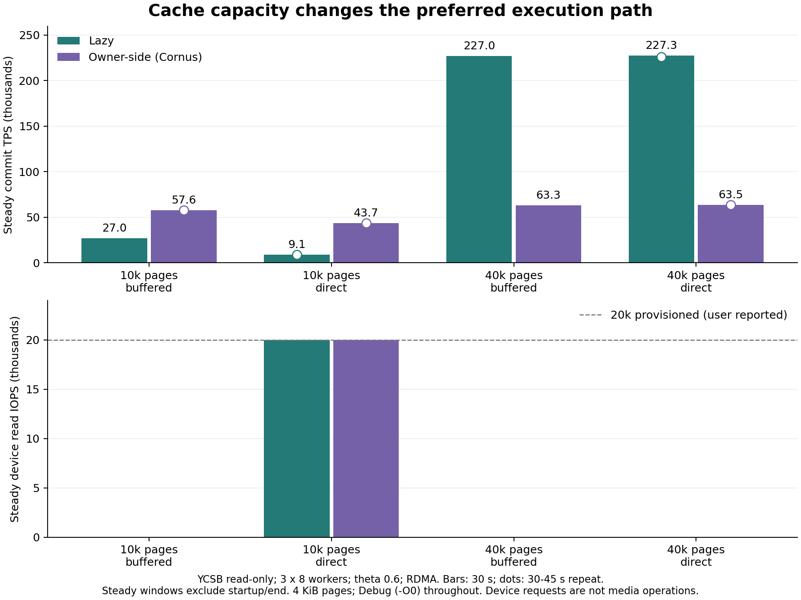

# Direct I/O 与缓存容量的成本边界（2026-11-05）

> 后续（2026-11-06）：LSN 读盘轮询已改成页面回放进度等待，同配置前后与并发扫描见
> [回放等待实验](REPLAY_WAIT_COST_BOUNDARIES_20261106.md)。本文保留当时的版本和数据；
> 下文含写小缓存 direct 异常不代表修复后性能。

本轮补充取页 Direct I/O 对照，研究目标见 [成本边界与模型方向](SHARED_STORAGE_COST_BOUNDARIES.md)。
新增读取方式、实际读调用/耗时/LSN 重读统计，并修正 2PC 存储取页重复计数。
没有改变事务协议、日志刷盘策略或混合选择规则。
计划包含 2 点启动检查、32 点矩阵与 8 点复验；启动检查不参与性能结论比较。

## 可以得出的结论

1. **缓存容量与副本复用改变执行方式的优劣，绕过存储 OS page cache 后仍成立。**
   YCSB 只读、每表每节点 10000 页缓存时，direct 下 Lazy/Cornus 约 0.87 万/4.33 万 TPS；
   40000 页时约 22.0 万/6.24 万，且稳态设备读 IOPS 为 0。
2. **每事务的 IO 需求与设备容量同样重要。** 小缓存只读的两个 direct 点都接近 2 万读 IOPS，
   但 Cornus 每笔事务的存储读取更少。仅比较一次读取延迟无法解释吞吐差距。
3. **容量淘汰不能解释全部含写差异。** 大缓存下，基线 Lazy 执行更贵、提交更便宜；
   热点下 Cornus 仍明显占优，两边淘汰均为 0。权限迁移、提交重取页和冲突路径需单独建模。
4. **含写小缓存的一个组合暴露了实现干扰。** θ=0.6 时 direct 产生大量 LSN 重读，
   回放线程被采样到等待 ext4 写锁。该结果不能解释为原子提交协议必然增加的成本。

## 实验与验证口径

三个计算节点，每节点 8 worker，RDMA、NO_WAIT、generate_log=1、local_ratio=0.5。
除只读点外 write_ratio=0.8；YCSB 表示十次操作中写操作的比例，SmallBank 表示写事务类型比例。
θ 基线 0.6，热点 0.95。YCSB 100000 条记录约 33335 页，SmallBank 300000 账户。
worker 使用独立固定 RNG，协议不参与 seed；时间模式不保证不同运行执行完全相同的前缀或调度。

沿用当前 CMake 的 -O0 -DDEBUG，未切换优化等级；这些结果用于机制定位，不代表优化构建峰值。
矩阵每点 30 秒，复验的大缓存只读点 45 秒，其余 30 秒。存储节点同时运行 remote_node。
实际文件系统为 ext4，块设备 nvme0n1；20k 预配置 IOPS 来自用户说明，未调用云 API。
小缓存只读实测接近 20000 次/秒设备请求，但设备计数不等于物理介质操作数。

Direct I/O 仅用于 GetPage / GetPageWithLsn 的对齐整页读取。初始化、元数据、WAL、回放写入沿用原路径，
因此含写时仍是 buffered write / direct read 混用，并非完整采用 Direct I/O 的存储实现。
开关默认 buffered；配置与统计说明见 [研究记录](SHARED_STORAGE_COST_BOUNDARIES.md#direct-io-对照开关)。

验证使用真实服务器：三个程序构建、四机源码和二进制核验、实际 O_DIRECT 描述符和设备读计数；
临时程序直接调用项目 DiskManager，验证整页及部分 buffered 写入的可见性、LSN 等待和关闭再打开。
没有向仓库添加模拟存储测试。report 对旧结果可生成 stats.log，summary_human.txt 保持原样。

执行/提交均值按成功事务计算，失败路径和每次尝试均值另保存在 metrics.json。
Commit TPS 为三个节点各自计时窗口速率之和；稳态 TPS 去掉启动/结束区间，设备指标取稳态重叠窗口。
节点没有严格同步的全局窗口。存储读调用和重读数覆盖全程，不能直接除以稳态时长当作稳态 IOPS。
read_count - lsn_retries 为完成的 RPC 页面读取数，含元信息页；pread 计时不含 RPC 排队和重试 sleep。
读取耗时总和可以跨并发调用重叠，不等于存储服务器运行时间。

原 fetch_from_storage_count 在 2PC 的 local_fetch 与底层 RPC 各加一次。
本轮删除调用者的两次重复递增，底层 RPC 统一计数；以前的原始文件不重写。
初始矩阵与复验因此有两个源码指纹，IO/协议代码一致，差别仅为计数修正。
下文每事务读需求使用新增存储计数，不使用旧重复计数。

最终校验通过：**42 次运行、126 份节点结果、113,640,463 次尝试、111,889,374 次成功**。
事务计数、提交路径计时、日志等待分类对齐；IO 配置与实际描述符一致，四机 RDMA 限速丢包为零，结束后服务均退出。

初始源码指纹：de408291851f6f7e482cfd569f682f1048312112f923de38bb92c98ad679d748。

最终源码指纹：34599621eccd0a9c7b1cabb9880043355e3b1142d117555cac00c27d05a23746。

## 只读：容量与设备读约束

| case | 模式 | IO | 缓存页 | Commit TPS | 稳态 TPS | 执行 ms | 提交 ms | 读 IOPS | 写 IOPS | LSN 重读 |
|---|---|---|---|---|---|---|---|---|---|---|
| 1 | Lazy | buffered | 10000 | 27033 | 26960 | 0.870 | 0.002 | 0 | 22 | 0 |
| 2 | Cornus | direct | 10000 | 43334 | 43696 | 0.539 | 0.001 | 19999 | 1 | 0 |
| 3 | Lazy | direct | 10000 | 8735 | 9119 | 2.730 | 0.002 | 19987 | 8 | 0 |
| 4 | Cornus | buffered | 10000 | 57207 | 57616 | 0.405 | 0.002 | 0 | 9 | 0 |
| 5 | Cornus | buffered | 40000 | 62836 | 63344 | 0.367 | 0.001 | 0 | 12 | 0 |
| 6 | Lazy | direct | 40000 | 219635 | 227324 | 0.095 | 0.002 | 0 | 1 | 0 |
| 7 | Cornus | direct | 40000 | 62386 | 63548 | 0.370 | 0.001 | 0 | 3 | 0 |
| 8 | Lazy | buffered | 40000 | 220882 | 226966 | 0.094 | 0.002 | 0 | 15 | 0 |

10000 页约 39 MiB/表/节点。Lazy 在请求节点缓存跨分区副本，工作集与淘汰压力更大。
Cornus 主要在固定 owner 访问，但三节点各 10000 页的总容量也略小于全表，因此仍有缺页。
40000 页约 156 MiB，可容纳全表；两种模式都没有淘汰，Lazy 可复用本地副本，Cornus 仍有远端调用。
当前 GetDataItem 按记录请求但返回整页，不能把它当作所有算子下推实现的上限。

用 buffered 小缓存只读点的实测读/事务 r，粗略外推 20000/r，可在没有拟合 direct 结果的情况下解释其量级：

| 模式 | buffered 读/事务 r | 20000/r TPS | direct Commit TPS |
|---|---|---|---|
| Lazy | 2.207 | 9060 | 8735 |
| Cornus | 0.473 | 42258 | 43334 |

这不是完整模型或严格吞吐上界。实际 r 随运行长度、预热、调度而变；缓存足够后更不能沿用小缓存的 r。
模型应感知缓存状态与资源需求，而不是为某个协议固定一个阈值。

## 含写：排除容量淘汰后的执行与提交

θ=0.6、40000 页，以下四点均无淘汰、无 LSN 重读，稳态设备读 IOPS 为 0：

| case | 模式 | IO | 缓存页 | Commit TPS | 稳态 TPS | 执行 ms | 提交 ms | 读 IOPS | 写 IOPS | LSN 重读 |
|---|---|---|---|---|---|---|---|---|---|---|
| 13 | Cornus | buffered | 40000 | 11865 | 11897 | 0.361 | 1.552 | 0 | 11371 | 0 |
| 14 | Lazy | direct | 40000 | 10817 | 11039 | 0.935 | 1.184 | 0 | 12762 | 0 |
| 15 | Cornus | direct | 40000 | 11660 | 11909 | 0.393 | 1.554 | 0 | 11392 | 0 |
| 16 | Lazy | buffered | 40000 | 10893 | 10943 | 0.907 | 1.197 | 0 | 12561 | 0 |

buffered 下 Lazy/Cornus 成功执行约 0.907/0.361 ms，提交约 1.197/1.552 ms。
支持“页面/权限协调增加执行成本、分布式提交增加提交成本”的分解，但不意味着所有场景都必须保持同样大小关系。

热点 θ=0.95，40000 页，以下四点同样无淘汰、无 LSN 重读：

| case | 模式 | IO | 缓存页 | Commit TPS | 稳态 TPS | 执行 ms | 提交 ms | 读 IOPS | 写 IOPS | LSN 重读 |
|---|---|---|---|---|---|---|---|---|---|---|
| 21 | Cornus | buffered | 40000 | 7169 | 7211 | 0.353 | 1.421 | 0 | 12516 | 0 |
| 22 | Lazy | direct | 40000 | 3184 | 3203 | 1.978 | 1.693 | 199 | 12993 | 0 |
| 23 | Cornus | direct | 40000 | 6982 | 7090 | 0.373 | 1.450 | 36 | 12181 | 0 |
| 24 | Lazy | buffered | 40000 | 3195 | 3203 | 1.947 | 1.703 | 0 | 12937 | 0 |

Cornus 仍约 7 千 TPS，Lazy 约 3.2 千，因此热点收益不能只归因于小缓存。
Lazy 提交重新取页约 0.33 ms/attempt，Cornus 约 0.002 ms/attempt；执行差距也保留。
权限迁移、执行/提交之间重新取页和冲突均需考虑；尚未通过独立消融分配各因素的贡献。
这些诊断细项存在重叠，不能直接相加为事务关键路径。

## 含写小缓存：LSN 读盘轮询干扰

θ=0.6、10000 页：

| case | 模式 | IO | 缓存页 | Commit TPS | 稳态 TPS | 执行 ms | 提交 ms | 读 IOPS | 写 IOPS | LSN 重读 |
|---|---|---|---|---|---|---|---|---|---|---|
| 9 | Lazy | buffered | 10000 | 10698 | 10728 | 0.942 | 1.201 | 0 | 12942 | 0 |
| 10 | Cornus | direct | 10000 | 609 | 106 | 18.322 | 21.575 | 19793 | 214 | 600216 |
| 11 | Lazy | direct | 10000 | 526 | 58 | 31.576 | 16.898 | 19862 | 143 | 635416 |
| 12 | Cornus | buffered | 10000 | 11761 | 11828 | 0.408 | 1.523 | 0 | 11586 | 0 |

两个 direct 点前几秒后明显降速，稳态 TPS 比全程均值更低。
现有等待新版本的逻辑是：读整页、检查 LSN、未满足则 sleep 10 μs 后再读。
buffered 重读可能命中 OS 缓存，direct 重读则再次进入设备路径。

- Cornus：633,441 次读调用，600,216 次 LSN 重读（94.8%）；完成页面读取仅 33,225 次。
- Lazy：667,879 次读调用，635,416 次 LSN 重读（95.1%）；完成页面读取仅 32,463 次。

case 10 三次低开销内核栈采样中，两次看到回放线程停在 rwsem_down_write_slowpath → ext4_buffered_write_iter，
同时多个 brpc worker 正在 ext4_file_read_iter / iomap_dio_rw 或 native sleep。
这证明存在文件读写锁等待；结合大量重读、约 2 万设备 IOPS、事务进度骤降，支持读轮询与回放写互相干扰的解释。
尚未通过独立消融确认全部降速比例，不能仅凭栈断言 bRPC 线程饥饿是唯一原因。

同一代码的热点小缓存组合没有 LSN 重读放大，大缓存也没有，因此不是所有含写 direct 场景都失效。
本轮保留异常与原始证据，没有临时改延迟或增加线程掩盖它。
后续应使页面就绪等待基于回放进度通知，避免读盘轮询 LSN，并明确数据页写入与 direct read 的协调策略，
再用这个组合标定通用模型。本轮不声称完成整个存储层的 Direct I/O 设计。

## 其他对照与复验

SmallBank 的当前每表工作集可放入 10000 页缓存，未观察到淘汰。
这检验计算侧已驻留后更换读取方式的影响，不能推广到更大的 SmallBank 数据集。

| case | 模式 | IO | 缓存页 | Commit TPS | 稳态 TPS | 执行 ms | 提交 ms | 读 IOPS | 写 IOPS | LSN 重读 |
|---|---|---|---|---|---|---|---|---|---|---|
| 25 | Lazy | buffered | 10000 | 903148 | 925976 | 0.017 | 0.003 | 0 | 4 | 0 |
| 26 | Cornus | direct | 10000 | 214026 | 217594 | 0.105 | 0.002 | 0 | 18 | 0 |
| 27 | Lazy | direct | 10000 | 905020 | 931433 | 0.017 | 0.003 | 0 | 1 | 0 |
| 28 | Cornus | buffered | 10000 | 215600 | 217961 | 0.104 | 0.002 | 0 | 8 | 0 |
| 29 | Cornus | buffered | 10000 | 27590 | 27693 | 0.097 | 0.766 | 0 | 14654 | 0 |
| 30 | Lazy | direct | 10000 | 28480 | 28638 | 0.184 | 0.649 | 0 | 15059 | 0 |
| 31 | Cornus | direct | 10000 | 27074 | 27476 | 0.103 | 0.777 | 0 | 14508 | 0 |
| 32 | Lazy | buffered | 10000 | 28822 | 28895 | 0.181 | 0.643 | 0 | 15237 | 0 |

关键点复验仅修正重复计数。小缓存 direct 的 Lazy/Cornus 顺序与矩阵相反；
大缓存只读延长至 45 秒，同时看稳态速率；热点大缓存独立重新启动。

| case | 模式 | IO | 缓存页 | Commit TPS | 稳态 TPS | 执行 ms | 提交 ms | 读 IOPS | 写 IOPS | LSN 重读 |
|---|---|---|---|---|---|---|---|---|---|---|
| 1 | Lazy | direct | 10000 | 9248 | 9131 | 2.578 | 0.002 | 19993 | 4 | 0 |
| 2 | Cornus | direct | 10000 | 43358 | 43673 | 0.539 | 0.001 | 19983 | 16 | 0 |
| 3 | Cornus | buffered | 10000 | 57139 | 57567 | 0.405 | 0.002 | 0 | 19 | 0 |
| 4 | Lazy | direct | 40000 | 221248 | 225935 | 0.094 | 0.002 | 0 | 10 | 0 |
| 5 | Cornus | direct | 40000 | 62941 | 63697 | 0.367 | 0.001 | 0 | 8 | 0 |
| 6 | Lazy | buffered | 40000 | 3245 | 3246 | 1.920 | 1.670 | 0 | 13095 | 0 |
| 7 | Cornus | buffered | 40000 | 7209 | 7259 | 0.345 | 1.418 | 0 | 12531 | 0 |
| 8 | Cornus | buffered | 10000 | 11756 | 11833 | 0.406 | 1.526 | 0 | 11568 | 0 |

矩阵单次加关键点复验不是统计显著性检验，不应解释 1%–3% 的小差异。
θ=0.95 小缓存的其余四点及全部失败路径、资源和日志指标保存在原始结果与 metrics.json。

## 后续与归档

先消除 LSN 读盘轮询干扰，再扩大数据规模与存储环境，使用统一优化构建检验边界。
之后用独立数据预测选择，评价预测误差、选择损失、适应时间与最优静态基线。
本轮没有重设计 RDMA 锁、修改提交协议，也未把研究转为云盘刷盘调度。

本地与开发服务器保存 result/direct_io_study_20261105；服务器绝对路径
/data/workspace/Hybrid_Cloud_MP/result/direct_io_study_20261105。
包含计划、配置、节点结果/TPS、存储统计、四机设备与 RDMA 采样、描述符记录、线程栈、
真实文件探针、分析与绘图脚本、初次/最终校验及部署审计。临时实验工具随结果归档，未添加到仓库根目录。
