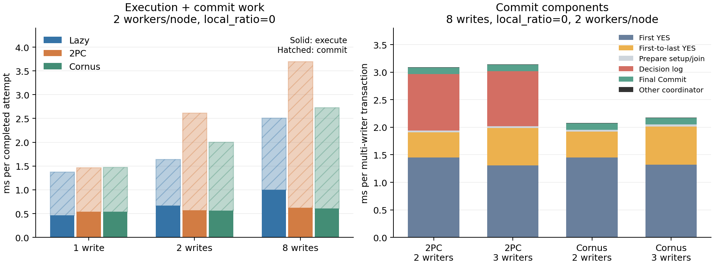
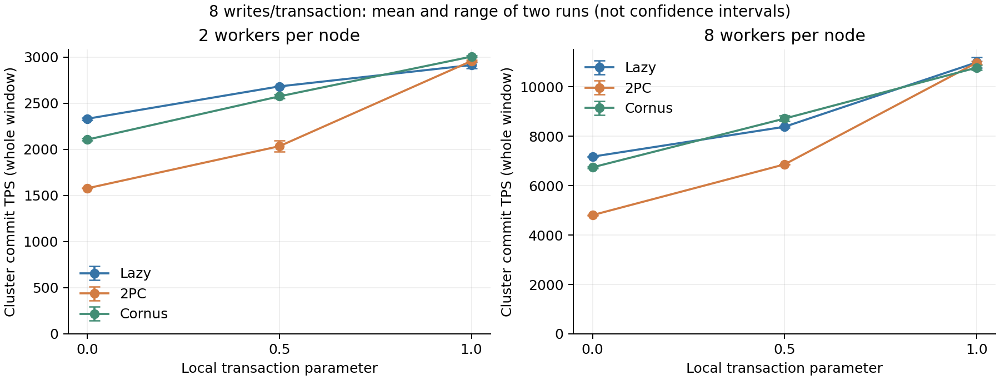

# Lazy 页面获取与 2PC 提交成本分析

本轮目标是量化页面获取与提交的成本，检验它们能否解释 Lazy、普通 2PC 和 Cornus 的胜负。
研究入口仍是 [共享存储事务处理的成本边界](SHARED_STORAGE_COST_BOUNDARIES.md)。
本轮修改测量口径，没有修改提交协议、刷盘策略或混合选择器。

目前能将主要差异落到具体成本上：Lazy 的页面与权限等待、提交时重取页，
以及 owner-side 的多写 Prepare、普通 2PC 决议日志和失败收尾。
固定调用次数配固定单价仍不足以预测所有场景：并发和冲突会显著改变这些单价。

## 执行、提交与失败工作共同决定胜负

下面先保留首轮固定矩阵，避免只挑性能最好的一轮。E/C 分别为每次完成尝试的执行/提交毫秒，TPS 为三节点之和。
1 次写时只有一个写参与者，普通 2PC 与 Cornus 使用相同的单写快速路径。

| 每节点 worker | local_ratio | 每笔计划写操作 | 模式 | E ms | C ms | Commit TPS |
|---|---|---|---|---|---|---|
| 2 | 0 | 1 | Lazy | 0.463 | 0.917 | 4298 |
| 2 | 0 | 1 | Cornus | 0.539 | 0.933 | 4033 |
| 2 | 0.5 | 1 | Lazy | 0.393 | 1.018 | 4204 |
| 2 | 0.5 | 1 | Cornus | 0.307 | 0.991 | 4572 |
| 2 | 0 | 8 | Lazy | 1.002 | 1.507 | 2345 |
| 2 | 0 | 8 | 普通 2PC | 0.622 | 3.077 | 1575 |
| 2 | 0 | 8 | Cornus | 0.607 | 2.125 | 2119 |
| 2 | 0.5 | 8 | Lazy | 0.708 | 1.485 | 2683 |
| 2 | 0.5 | 8 | Cornus | 0.342 | 1.936 | 2556 |
| 8 | 0.5 | 8 | Lazy | 0.958 | 1.775 | 8349 |
| 8 | 0.5 | 8 | 普通 2PC | 0.347 | 2.830 | 6860 |
| 8 | 0.5 | 8 | Cornus | 0.354 | 2.127 | 8830 |

只写 1 条记录时，Lazy 的页面副本可以服务后续读操作，执行并不必然比 owner-side 慢。
随机分区分支下，Lazy 每次尝试约 6.63 次取页直接本地完成，而 owner-side 仍有约 6.60 次 remote fetch。
混入全本地事务后，owner-side 的远程调用数显著下降，执行优势转向另一边。

只读控制点也验证了复用的另一端：8 worker、半本地、40000 页缓存时，统计版两次运行的 Lazy 平均约 219388 TPS，
Cornus 模式约 62763 TPS。这里没有多写提交，约 3.50 倍的差距来自执行路径，不能解释为省去了 2PC 的多写日志。
该点没有容量淘汰，不代表小缓存时继续复制页面也能获得相同收益。

8 次写、local_ratio=0 时，Cornus 节省约 0.395 ms 执行时间，却增加约 0.618 ms 提交时间，所以 Lazy 领先。
普通 2PC 还保留协调者决议日志，提交增量更大。
半本地负载从 2 增到 8 worker 后，Cornus 的执行节省从约 0.366 增到 0.604 ms，提交增量从约 0.451 降到 0.352 ms。
因此执行收益可以覆盖提交代价，首轮吞吐发生反转；回滚和其余工作仍要另外计入总成本。



## 反向顺序复测

8 次写的六组配置各做两轮，第二轮反转模式顺序。下表是 TPS 均值及 `[最小值, 最大值]`，不是置信区间。

| worker/节点 | local_ratio | Lazy | 普通 2PC | Cornus |
|---|---|---|---|---|
| 2 | 0 | 2332 [2320, 2345] | 1579 [1575, 1582] | 2106 [2094, 2119] |
| 2 | 0.5 | 2683 [2683, 2684] | 2035 [1976, 2094] | 2575 [2556, 2594] |
| 2 | 1 | 2915 [2882, 2948] | 2958 [2950, 2967] | 3006 [2998, 3015] |
| 8 | 0 | 7176 [7175, 7177] | 4809 [4796, 4822] | 6744 [6711, 6776] |
| 8 | 0.5 | 8385 [8349, 8422] | 6863 [6860, 6866] | 8717 [8604, 8830] |
| 8 | 1 | 10991 [10776, 11206] | 10978 [10903, 11053] | 10778 [10673, 10884] |

高跨节点点两轮都是 Lazy 领先；半本地从低并发到高并发的反转方向也得到重复。
不过高并发半本地点的 Cornus 优势分别约 5.8% 和 2.2%，应视为接近边界，而非稳定的大幅优势；还要结合下文的统计开销对照。
全本地点各模式较接近，没有多写提交，不能用其中的排名解释多写协议优劣。



## 一次获取到底花在哪里

以首轮 2 worker、8 次写、local_ratio=0 为例：

| 请求端诊断 | 次数每尝试 | ms 每次 | ms 每尝试 |
|---|---|---|---|
| Lazy 等待回收或授权的取页 | 6.316 | 0.1321 | 0.834 |
| Lazy 其他 execute 取页路径合计 | — | — | 0.084 |
| Lazy execute 全部取页 | — | — | 0.918 |
| Cornus remote fetch | 6.571 | 0.0799 | 0.525 |

取页相关差值约 0.393 ms，与完整执行阶段的 0.395 ms 差值接近。
这里说明执行差的主要部分确实能落到路径次数和单次成本上；同运行分解相符本身并不是跨负载预测的证明。
两边剩余执行工作仍存在，不能把 remote fetch 时间当作整个 owner-side 执行时间。

在 1 次写的随机分区点，Lazy 的 local_manager/owner_manager 路径约 0.084/0.083 ms，第三方转发约 0.145 ms。
这与 manager、页面来源、请求者的放置影响通信路径相符；没有把差值直接换算成一个纯网络 RTT。
本地可用路径约 0.0018 ms，副本复用可以避免大量远程获取。
这些单价都含当前负载下的服务处理和等待，不是硬件或协议永久不变的常数。

在半本地、8 次写点，并发带来的变化主要能定位到等待路径：

| 诊断 | 2 worker/节点 | 8 worker/节点 |
|---|---|---|
| Lazy wait_release 次数/尝试 | 4.739 | 4.783 |
| Lazy wait_release ms/次 | 0.1218 | 0.1683 |
| Lazy execute 全部取页 ms/尝试 | 0.634 | 0.860 |
| 上行包含的本地锁调用 ms/尝试 | 0.004 | 0.031 |
| Cornus remote fetch 次数/尝试 | 3.275 | 3.222 |
| Cornus remote fetch ms/次 | 0.0780 | 0.0822 |

Lazy 的等待取页单价增加约 38%，远程代执行 RPC 单价增加约 5%。次数相近时，单价变化已经解释了大部分新增执行差。
本地锁调用时间包含在取页时间中，不能再加一次；等待回收路径还包括远端处理及通知，
这里没有把它全部解释成网络 RTT，也没有进一步隔离为磁盘、锁排队或某个线程调度器的单独因果贡献。

## Prepare 首尾差有意义，但不是全部提交增量

下面取相同的 8 次写、local_ratio=0、2 worker 点，按实际写参与者数分组。
时间单位为每个组内事务的毫秒，提交总计还包含少量请求构造与其余协调工作。

| 模式 | 写参与者 | 首个 YES | 首尾 YES 差 | 决议日志 | 最终 Commit | 完整提交 |
|---|---|---|---|---|---|---|
| 普通 2PC | 2 | 1.449 | 0.457 | 1.028 | 0.119 | 3.090 |
| 普通 2PC | 3 | 1.309 | 0.678 | 0.997 | 0.120 | 3.143 |
| Cornus | 2 | 1.452 | 0.468 | 0 | 0.119 | 2.076 |
| Cornus | 3 | 1.317 | 0.697 | 0 | 0.120 | 2.174 |

3 个写参与者的首尾差确实更大，但首个 YES 更早，因此 Cornus 的完整提交只增加约 0.098 ms，而不是首尾差增加的 0.229 ms。
参与者是否包含 home、总写集如何分摊、请求到达时机和排队都可能变化。
这些是同一负载内的条件分组，未隔离为“只改变参与者数、其他一切完全相同”的因果实验。

模型应估计一笔事务的完成时间最大值，不能用参与者平均时间的最大值代替它。
也不能把首个 YES 当成 Lazy 的提交成本：两者的写入内容、并发请求、通知和等待边界都不同。

一个只用于说明口径的例子：若两个完成延迟的均值都为 μ，单次等待的基准均值也是 μ，
由 `max(X1,X2) = (X1 + X2 + |X1-X2|) / 2` 可得，等待最慢者的平均增量是平均首尾差的一半。
现实中的 Lazy 与 Prepare 并不自动满足这个共同基准，所以更不能直接把首尾差全部加到 Lazy 提交时间上。

## 相同刷盘方法并不意味着相同等待成本

在 1 次写的普通 2PC 对照中，local_ratio 从 0 变到 1，平均 fdatasync 约从 0.492 变为 0.511 ms，
而事务的 commit 日志等待从约 0.865 增至 1.283 ms；日志 RPC 的批次平均时间约从 0.631 增至 0.680 ms。
这些均值的分母不同，不能简单相减得到精确队列等待。
但它们已经足以说明，单次 fdatasync 不能代表事务完整的持久化等待。

代码仍是每计算节点一条日志流、同一流一个在途批次，主动同步请求立即唤醒刷新线程。
到达时机及合批会影响事务等待当前批次还是后续批次；设备与调度也影响等待。
本轮没有逐项分离这些原因，更没有为了使协议结果符合预期而改变刷盘方法。

全本地单写时，普通 2PC 与 Cornus 走相同快速路径。它们出现的几个百分点差异应作为实验波动检查，不能解释成 Cornus 的多写协议收益。

在半本地、8 次写点，还能看到逻辑日志工作与设备调用次数的区别：

| worker/节点 | 模式 | fdatasync 次数/成功提交 | WAL KiB/成功提交 | 稳态设备写 IOPS | 稳态写 MB/s |
|---|---|---|---|---|---|
| 2 | Lazy | 1.042 | 10.22 | 8031 | 111 |
| 2 | Cornus | 1.132 | 14.50 | 8255 | 128 |
| 8 | Lazy | 0.338 | 10.30 | 8215 | 180 |
| 8 | Cornus | 0.295 | 14.64 | 7699 | 217 |

并发增大后，合批使多笔事务共享持久化调用，Cornus 的平均 fdatasync 次数甚至低于 Lazy，
但 WAL 字节仍更多。不能把“多个写参与者”直接换算成同样倍数的物理 IOPS。
每次成功提交的计数是系统总工作量的摊销，也包含失败尝试产生的日志。
右两列包括回放及文件系统 IO，采用稳态公共窗口；左两列来自全程计数，不能跨窗口相乘作精确守恒。
本轮没有取得云盘限额配置，不能仅凭 IOPS 曲线趋平或设备 busy 为 100% 就断言触发了某个配额。

## SmallBank 的平均提交不能只看一个路径

SmallBank 的同环境补充点为每节点 2 worker、local_ratio=0.5、写事务比例 0.8：

| 模式 | E ms 每尝试 | C ms 每尝试 | Commit TPS |
|---|---|---|---|
| Lazy | 0.163 | 0.780 | 6328 |
| 普通 2PC | 0.099 | 1.023 | 5318 |
| Cornus | 0.096 | 0.818 | 6525 |

这里 Cornus 的提交仍比 Lazy 多约 0.038 ms，但执行节省约 0.067 ms，整体略胜。
普通 2PC 的提交增量约 0.243 ms，超过执行节省，因此落后。

Cornus 的提交组成约为 20.1% 只读、30.3% 单本地写、24.8% 单远程写、24.8% 多写。
这三类写路径分别约 0.923、0.957、1.214 ms；加权后才得到整体约 0.818 ms。
Lazy 的写事务全归到 single_local，该组约 0.976 ms；其余约 20.1% 为只读。

因此不能把 Lazy 的 single_local 与 Cornus 的 single_local 当成相同事务集合：
前者包含所有写事务，后者只是 owner-side 单本地写子集，业务类型和实际写入内容可能不同。
本轮用全负载对照解释吞吐，不把两个不同子集的均值差冒充逐笔协议增量。

## 高冲突下，本地命中与提交都可能等页面

把半本地、8 worker、8 次写点的 theta 从 0.6 改为 0.95，首轮结果如下。
这里 E/C 使用成功事务作为分母，失败耗时单独列出；W 为全部尝试耗时摊到每次成功提交。

| 模式 | Commit TPS | 失败比例 | 成功 E ms | 成功 C ms | 失败尝试平均 ms | W ms/成功提交 |
|---|---|---|---|---|---|---|
| Lazy | 2330 | 51.8% | 2.493 | 2.419 | 4.969 | 10.293 |
| 普通 2PC | 4102 | 56.9% | 0.338 | 2.852 | 1.988 | 5.848 |
| Cornus | 5203 | 51.4% | 0.343 | 2.099 | 2.022 | 4.610 |

Lazy 与 Cornus 的失败比例相近，但失败尝试耗时相差约 2.46 倍，不能只以失败比例修正吞吐。
即使普通 2PC 的失败比例更高，其失败工作和成功执行都更短，整体仍高于 Lazy。

Lazy 的 execute 取页约 2.808 ms/尝试，其中包含约 1.214 ms/尝试的本地锁调用。
wait_release 从低冲突时的约 0.168 增至 0.601 ms/次。
甚至 `local_ready` 也达到约 0.126 ms/次，其本地锁调用累计约 0.446 ms/尝试。
代码中的 `LockShared/LockExclusive` 会等待本地使用者、正在获取权限的线程或 pending 回收；
返回“不必自行请求远端权限”不等于完全没有等待。因此不能给所有本地命中固定填 0。

**这里 Cornus 的成功提交阶段反而比 Lazy 短，有具体的时间来源。**
Lazy 在 commit 阶段重取页约 0.466 ms/尝试，换成成功提交分母约 0.968 ms/笔，已经包含在 2.419 ms 内。
这是提交阶段的页面与锁工作，不是证明 Cornus 的单次刷盘更快，也不能把它重复加到 commit 总时间上。

同并发、低冲突参考点的单价在这里明显失效：总耗时分别低估 Lazy 约 63%、普通 2PC 约 32%、Cornus 约 33%。
这组出界结果必须与前面的约 4% 误差一起报告。下一步模型需要同时更新争用条件下的获取单价、提交重取页成本和失败工作，
仅靠实际调用次数、写参与者数及低冲突平均单价还不够。

反向顺序复核得到 Lazy/普通 2PC/Cornus 约 2260/4080/5107 TPS，方向与量级一致。
Lazy 的失败尝试约 5.162 ms，Cornus 约 2.060 ms；成功提交阶段分别约 2.512/2.140 ms，
再次出现 Lazy 提交阶段更长。因此这不是只出现在单次热点运行中的现象。

## 存储通知版的关键路径

8 worker、半本地、8 次写的专门配对点中，Cornus 约 8774 TPS，Cornus-opt 约 8578 TPS。
多写事务的 Prepare 分别约 2.329/2.280 ms，最终 Commit 分别约 0.140/0.217 ms，完整提交约 2.475/2.504 ms。
因此不能只看 Prepare 略短就认定整体提交更快。

代码中存储通知可能先于参与者收到 LogWrite 回复；参与者在日志等待返回后才 `MarkPrepared`，
提前到达的 Commit 会在 `TakeForCommit` 等待该状态。这允许一部分原先位于 Prepare 阶段的等待移到最终 Commit。
上述分解与这种移动相符，但本轮没有独立测量这段条件变量等待，不能把全部差值都归因于它。
正常 Cornus 的协调者首尾 YES 差约 0.775 ms；Opt 的存储首尾票观察差约 0.745 ms。
两者观测位置不同，不能相减得出通知网络开销。

反向复测中 Cornus/Opt 约 8835/8565 TPS，多写 Prepare 约 2.309/2.286 ms，最终 Commit 约 0.140/0.219 ms，
阶段变化方向一致。两轮平均约为 8805/8572 TPS；当前配置下未观察到存储通知版的吞吐收益，不能据此否定其他网络与并发条件下的收益。

## 统计自身的净开销

同一负载依次跑原版 A、统计版 B、统计版 B、原版 A；每点 45 秒，两版优化参数均为 `-O0 -DDEBUG`。
原版已经含有原有统计及旧 RTT 计数，因此这里只测本轮替换和新增计时的净变化。

| 负载 | 模式 | 原版平均 TPS | 统计版平均 TPS | 变化 |
|---|---|---|---|---|
| 8 worker，只读 | Lazy | 224885 | 219388 | -2.44% |
| 8 worker，只读 | Cornus | 62491 | 62763 | +0.43% |
| 2 worker，8 次写 | Lazy | 2688 | 2680 | -0.29% |
| 2 worker，8 次写 | Cornus | 2627 | 2618 | -0.34% |
| 8 worker，8 次写 | Lazy | 8299 | 8238 | -0.74% |
| 8 worker，8 次写 | Cornus | 8965 | 8761 | -2.27% |

只读 Lazy 的计时成本可见，不能称为无开销。含写 Lazy 的原版两轮为 2762/2614 TPS，本身波动约 5.7%；
两轮均值接近不代表净开销精确等于 0.29%。同样，不把 Cornus 的小幅正变化解释为统计使引擎加速。

高并发含写点的原版两轮也都是 Cornus 领先 Lazy，均值约高 8.0%；统计版同组约高 6.4%。
因此该配置的胜负方向并非新增计时把 Lazy 拖慢后才出现。但净变化随负载不同，不宜统一减掉一个固定百分比来“校正”所有结果。

## 实验环境与口径

使用新镜像恢复的三个计算节点 `.130/.133/.134`，开发及存储节点的 RDMA 地址为 `.128`。
四台机器的程序哈希一致，使用 RDMA、NO_WAIT、日志开启、buffered 读页和 `-O0 -DDEBUG` 构建。
这里的 Cornus 名称对应项目中省去决议日志的正常提交路径，尚不包含完整 LogOnce、故障恢复及接管实现。
`parallel_page_fetch=0`，每节点 2 或 8 个 worker，每个 worker 一个协程；日志后台周期 3 ms、批触发值 16，主动同步请求仍立即唤醒。
存储节点现在使用 40 GB 系统盘；不能沿用已释放实例的 20000 预配置 IOPS，也不将新旧实例的绝对性能差异归因于本轮统计代码。
设备请求数来自 `/proc/diskstats`，包括 WAL、回放和文件系统工作；不是事务数或 fdatasync 次数。

正式点每次运行 45 秒，每表每节点 40000 页缓存。YCSB 每笔选择 10 个 key，写比例 0.1/0.2/0.8 对应计划中的 1/2/8 次写操作；重复 key 会去重。
`local_ratio` 控制全本地事务与随机分区事务的混合比例，不能直接当成单次访问的本地概率。
当前生成器使用 `FastRand % 100 > local_ratio * 100`，参数 0/0.5/1 对应约 99%/49%/0% 的随机分区分支；随机分区分支仍可能访问本节点。
统计使用实际路径和实际写参与者数量，未为这轮实验修改生成器。

时间分解按全程已完成尝试，包括回滚与结束边界内完成的事务。
TPS 使用各节点完整测量窗口；另从两秒日志中截去前约 6 秒及末端，保留中间和末约 15 秒的吞吐检查。
阶段计时不是这些截取窗口的计时，不能把两种窗口直接混用。
各节点有本地起跑屏障，没有严格的全局起跑屏障；存储设备指标使用节点窗口的交集。
大缓存消除了容量淘汰变量，但全程计时仍包括首次取页；buffered 读页不能解释成每次都触发物理盘读取。

## 本轮测量复用了什么

主阶段、四种提交路径、日志等待分类、Prepare/决议/最终 Commit 阶段和 remote fetch 的边界均沿用现有实现。
`summary_human.txt` 保留原组织形式，详细诊断继续放在 `stats.log` 的 `time_details` 中。
新增口径和代码位置见 [统计说明](benchmark_stats.md#页面获取与多写提交成本)。

旧的 2RTT/3RTT 及 direct/wait 计数在请求端、GPLM 和回收端有重复或不同含义，不能用它们计算每次获取的平均网络轮次。
现在每次请求只归入一条路线，记录次数、总时间和包含在其中的本地锁调用时间：

| 路线 | 含义 | 成本解释 |
|---|---|---|
| local_ready | 本次调用不自行发起远程权限请求 | 可复用本地副本；仍可能先等待本地锁或同节点先前的获取 |
| local_manager | manager 在请求节点，页面由别的节点提供 | 省去远程访问 manager 的一段通信 |
| owner_manager | 远程 manager 同时持有有效页面 | manager 可以直接安排推送 |
| forwarded_page | 请求节点、manager、页面来源分离 | 增加通知或转发路径 |
| local_upgrade | 本地副本仍有效，需要获得相应权限 | 不等于重新传输整页 |
| storage_page | 获权后从存储读页 | 含存储 RPC 与需要时的回放等待 |
| wait_release | 等待回收或后续授权通知 | 可包含排队、回收、多持有者处理和异步推送 |

这些是互斥的请求路径，不是固定 RTT 数。等待路径也可能在请求端开始等待前已经完成部分工作。
取页时间包含本地锁调用；旧 `ownership_transfer_time_total` 从该调用之后开始，两个时间值不能强求相等。
所有非 local_ready 的次数之和与旧 `ownership_transfer_count` 对账；后者的历史名称也包含初次从存储取页和本地副本升级。
execute/commit/abort 的取页分组可以区分执行获页、提交重取页和失败收尾。

普通 2PC 与 Cornus 记录同一协调者时钟上的 Prepare 回调：

```
Prepare = 请求构造及剩余协调工作 + first_yes + first_to_last_yes
多写 Commit = Prepare + 决议日志（若有）+ 最终 Commit + 其余协调工作
```

`first_yes` 从开始发送到首个成功回调，`first_to_last_yes` 是末回调减首回调。
时间在回调中记录，不按 Join 顺序推算。首尾差同时受到发出时差、排队、日志持久化和回复网络影响，不是纯磁盘尾延迟。
Cornus-opt 按存储通知推进，另记存储观察首票到末票的间隔，不与协调者时钟拼接。

写参与者计数区分 0/1/2/3，原有只读、单本地写、单远程写、多写路径继续保留。
Lazy 的实际写参与者是 home，所以写事务归入 1；这不代表它的逻辑数据只来自一个分区。
不同模式的事务流使用相同的 worker 种子规则，但时间模式处理的前缀长度不同，不能声称逐笔一一配对。

## 成本模型的检查方式

先计算执行节省 `E_Lazy - E_owner` 与提交增量 `C_owner - C_Lazy`，再检查它们对应哪些路径、多少次调用及多长的单次成本。
对回滚较多的点，还要将失败工作纳入每次成功提交的摊销成本，不能只比较成功事务或回滚比例。

进一步用本地事务比例 0.5 的点作为参考，冻结其单位成本，用其他本地性点的实际路径次数重建时间：

- Lazy 执行：各条 execute 取页路径的次数乘参考单价，加参考点的其余执行成本。
- Lazy 提交：提交重取页单独计价，剩余提交成本按进入提交的事务数缩放。
- owner-side 执行：remote fetch 次数乘参考 RPC 单价，加参考点的其余执行成本。
- owner-side 提交：只读、单本地写、单远程写分别计价，多写按 2/3 个写参与者的参考成本计价。

写操作数分别校准，避免用 1 次写的日志负载估算 8 次写。
并发变化时分别检查冻结低并发成本，以及刷新到同并发参考点后的结果。

| 单位成本来源与目标 | 独立目标点 | 执行平均绝对相对误差 | 提交平均绝对相对误差 | 总耗时平均绝对相对误差 |
|---|---|---|---|---|
| 2 worker 半本地参考，重建其他本地性 | 18 | 8.2% | 12.5% | 10.5% |
| 冻结 2 worker 成本，重建 8 worker | 6 | 16.8% | 17.2% | 19.0% |
| 刷新为 8 worker 半本地参考，重建相同目标 | 同一 6 点 | 13.0% | 6.2% | 5.3% |

首行使用三个写比例各自的半本地参考，检验 local_ratio=0/1 的三种模式。
后两行只比较同样的 6 个目标：8 worker、8 次写、local_ratio=0/1；半本地点用于校准，不计入检验。
刷新单位成本后总误差明显减小，支持保留运行时成本观测。
但低并发全本地点仍有约 24% 的总耗时低估，不能仅用这组平均误差宣称固定模型已经足够准确。

另外以完整的第二轮 8 worker 九个点作为验证集：冻结 2 worker 单价时，总耗时平均绝对相对误差约 18.4%；
使用首轮 8 worker 半本地单价时降为约 4.0%。参考与目标来自不同运行，模式和本地性均保留在原始重建文件中。

该检查使用目标运行已经发生的路径次数与提交分类，是跨实验的耗时重建，尚不是运行前的在线反事实预测。
同一份实验的阶段相加只能证明记账一致，不能单独证明选择模型有效。

冻结低并发成本会在首轮 8 worker、半本地点继续选择 Lazy，而该点 Cornus 的实测 TPS 更高，
选择损失约 5.45%。这说明即使知道目标运行的实际调用次数，过期单价也能导致错误选择。
`selection_reconstruction.json` 保存每组选择和按实测 TPS 计算的损失；这些选择仍使用事后路径次数与成功率，
不能作为上线前就能达到该准确度的证据。

## 现有选择器需要重新校准的部分

当前 `OnlineCommitCost::Estimate` 仍把最终 Commit 建模成 RPC 加一次 commit 日志等待，再加入协调者决议日志，并将相对 Lazy 的差值截断为非负。
当前完整写集 Prepare 路径的最终 Commit 已不再同步等待结束日志；Cornus 又省去了独立决议等待。
因此不能不区分协议，直接把旧公式用于本轮三种提交机制。

现有 `Model::Decide` 只对多写参与者启用该模型；本轮的单写与只读比较同样可能出现不同执行方式的收益。
后续应在这次实测边界上修改模型，而不是先给旧公式再加一个固定常数。
本轮没有修改这些策略，也没有声称已经得到优于所有静态模式的混合系统。

下一步先做一个可检验的、协议分明的成本估计器：

1. 将执行成本收成三类：本地可用、需要获取权限或页面、owner-side RPC。细路线用于解释单价变化，先不全部变成决策参数。
2. 提交按只读、单本地写、单远程写、多写估计；多写使用每笔事务的完整 Prepare 完成时间，并按普通 2PC/Cornus/Cornus-opt 分开。首尾差保留为诊断，不能再加到已经包含它的完整 Prepare 上。
3. 将失败尝试成本摊到成功提交：`W = 全部尝试的事务耗时 / 成功提交数`。比较成功事务均值或失败比例都不足以替代这个量。W 是工作线程耗时，不等于存储设备服务需求。
4. 先在独立负载点评价耗时误差和选择损失，再接到混合执行；把决策、探索及缓存状态改变的开销一起计入实跑。

当前 YCSB 能在执行前生成访问集合，通用 SQL 未必能提前知道完整读写集。
真正运行时决策只能使用当时已知的页面状态、已出现的参与者，以及由历史估计的后续访问，不能使用事后统计作为输入。
若选择粒度变成逐次访问，应计新增写参与者带来的边际提交成本，不能每次 remote fetch 都重复收取整笔多写提交成本。
缓存容量与复用收益继续沿用前轮独立证据；本轮大缓存、零容量淘汰的结果没有校准缓存挤占的代价。

## 原始证据

本地和开发机均保留 `result/cost_attribution_20261106/`。
各点包含 case plan、去除凭据的配置快照、节点 result.txt/TPS 日志、存储统计和系统采样。
`metrics.json` 汇总测量，`validation.json` 保存实际结果的对账检查，`reconstruction.json` 保存参考点和耗时重建。
`source_manifest.json`、`instrumentation.diff` 和 `deployment_audit.json` 保存源码与部署依据。
分析及临时实验驱动保存在结果目录，没有新增仓库根目录测试脚本。
这轮早期生成的旧摘要仍可能把已停止生成的 RTT 字段列为 0；这些值不是测量结果，分析使用节点的新路径计数与 stats.log，旧摘要不回写。

最终共完成 105 次集群运行，包括功能点、原版对照和重复测量，不是 105 个互不重复的负载配置。
315 份节点日志未发现断言失败或崩溃记录；真实结果的事务覆盖、提交分类、日志等待、页面调用、writer 分组和 Prepare 首尾计时对账均通过。
四台运行程序已恢复为同一统计版，哈希一致，实验及采样进程均已结束。
收尾文件与核对见 `final_source_manifest.json`、`final_deployment_audit.json`、`final_validation.json`；
原版/统计版构建参数对照保存在 `build_configuration_comparison.txt`。
