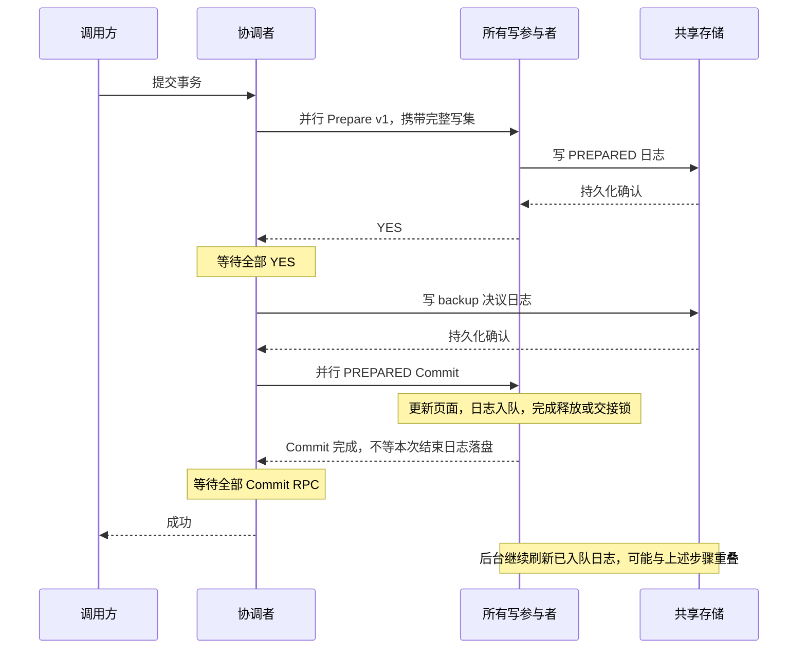

# mix 在线成本模型与 2PC 提交基线变更总结

记录日期：2026-11-03，时区 Asia/Shanghai。

后续研究进展（2026-11-05）：当前目标与缓存空间成本假设见
[共享存储事务处理的成本边界](SHARED_STORAGE_COST_BOUNDARIES.md)，
固定 worker 随机流后的实验见 [51 点重测](WORKER_RNG_STUDY_20261105.md)。
新研究模型尚未替换本文描述的早期 mix 选择器。
2026-11-06 补充 [页面回放等待与执行/提交成本边界](REPLAY_WAIT_COST_BOUNDARIES_20261106.md)：
消除 Direct I/O 版本轮询，并对比并发、缓存容量、日志批量和普通 2PC；没有修改本文的混合选择规则。

本文同时记录上一轮已提交的实现，以及本轮随本文一起提交的修改。它解释实现动机、调用路径、配置、统计口径、实验范围和验证边界，便于后续复现实验或审查代码。

**当前最重要的区别：关闭 `cornus_prepare_commit` 后，多写参与者 UPDATE 事务也先持久化完整 Prepare 写集；它仍等待参与者 YES 和协调者决议日志，但不再等待参与者 Commit 结束日志落盘。打开优化时，继续使用存储直通知，并取消协调者决议日志。两种路径都同步等待全部 Commit RPC 完成。**

**本文不表示已经实现完整 Cornus 容错。Prepare 中保存恢复证据，与已经实现故障恢复，是两件不同的事。**

## 1. 版本范围与时间线

| 版本 | 日期 | 内容 | 本文定位 |
|---|---|---|---|
| `a87cc56` | 2026-10-26 | `feat(2pc): persist prepare votes and notify coordinators from storage` | 前置工作：完整 Prepare、优化开关、存储直通知等 |
| `0f3f7de9d1c6fce6b545abf65d2bede956084a7a` | 2026-10-27 | `feat(mix): add online page and commit cost selection` | 上一轮已提交：成本选择模型、在线采样、身份修复、文档和测试 |
| 本文所在提交 | 2026-11-03 | 原始 2PC 基线使用持久化写集，取消参与者 Commit 刷盘等待 | 本轮修改：协议接入、遥测适配、测试、实验配置和本总结 |

上一轮提交涉及 28 个文件，新增 1,898 行、删除 39 行。它包含部分此前已经编写但当时尚未进入版本历史的 Cornus 说明文档，因此不能根据文档首次加入该提交，就把其中所有功能都归为上一轮新实现。

本轮在加入本文之前涉及 10 个已跟踪文件，新增 82 行、删除 42 行。其中配置文件的修改来自本次实验部署，其他 9 个文件为提交路径和测试适配。本轮不修改历史实验结果。

## 2. 术语与三种提交路径

### 2.1 本文中的“原始 2PC”有两个时间版本

- **旧基线**：上一轮实验使用的实现。Prepare 仅持久化事务标记；Commit 收到最终写集后，参与者等待更新及结束日志落盘再回复。
- **新基线**：本轮重跑使用的实现。Prepare 持久化完整最终写集；参与者 Commit 不等待本次结束日志落盘，但协调者决议日志及全部 Commit RPC 等待仍存在。
- **优化版**：Prepare 持久化完整最终写集，存储收齐持久化 YES 后直接通知协调者；不写协调者 backup 决议日志；Commit 不等待本次结束日志落盘。

这三者都运行在项目的共享存储架构上。它们的对比不是共享存储与 share-nothing 两种完整数据库架构的对比。

### 2.2 协议与等待点对照

下表仅描述开启日志的多写参与者、已有记录 UPDATE 路径。

| 项目 | 旧基线 | 新基线 | 优化版 |
|---|---|---|---|
| `cornus_prepare_commit` | 0 | 0 | 1 |
| Prepare 协议版本 | 0，事务 ID 标记 | 1，`kParticipantReplyVersion` | 2，`kProtocolVersion` |
| Prepare 保存完整最终写集 | 否 | 是 | 是 |
| Prepare 持久化后才能继续 | 是，但仅有标记 | 是，覆盖完整写集 | 是，覆盖完整写集 |
| 协调者获知所有 YES 的方式 | 等全部 Prepare RPC 回复 | 等全部 Prepare RPC 回复 | 等存储 `AllPrepared` 通知 |
| 协调者 backup 决议日志 | 写入并等待持久化 | 写入并等待持久化 | 不写 |
| Commit 请求类型 | `LEGACY`，携带最终值 | `PREPARED`，按身份使用准备上下文 | `PREPARED`，按身份使用准备上下文 |
| Commit 正常更新页面、生成日志、交接锁 | 是 | 是 | 是 |
| 参与者等待本次 Commit 结束日志落盘 | 是 | 否 | 否 |
| 协调者等待全部 Commit RPC | 是 | 是 | 是 |
| `AsyncCommit2pc` | false | false | false |

`PREPARED` 是 Commit 请求的处理类型，不等于开启了存储直通知。新基线和优化版共用这类 Commit handler；它们的 Prepare 完成条件、协调者决议日志要求仍不同。

### 2.3 “日志入队”不等于“日志持久化”

日志入队表示日志对象及其拥有的数据字节已交给节点的日志队列。后台线程会按批次发送到存储；只有经过持久化确认，才能认为相关日志已经落盘。

新基线取消的是参与者 Commit 对本次结束日志的同步等待，不是关闭日志，也不是取消 Prepare 或协调者决议日志的持久化要求。页面推送、迁移、淘汰所需的日志等待继续保留。

## 3. 上一轮：mix 页面成本选择器

主要实现位于 [page_cost_model.h](../core/compute_node/page_cost_model.h)、[dtx.cc](../core/dtx/dtx.cc)、[dtx_exe.cc](../core/dtx/dtx_exe.cc) 和 [local_LR_page_lock.h](../core/LPLM/local_LR_page_lock.h)。

### 3.1 解决的问题

单凭热点比例选择 Lazy 或 2PC，不能直接反映当前节点是否已经拥有所需页面权限，也不能反映某页近期的实际获取成本。上一轮增加本节点成本历史，用来估算：本事务采用 Lazy，需要为页面获取付出多少额外时间；这些时间是否高于采用 2PC 的额外提交成本。

该模型服务于 mix 模式，不替代事务实际执行中的权限获取、行锁、日志或一致性检查。预测认为页面可用，执行时仍须正常加锁。

### 3.2 决策时机和适用范围

1. workload 先构造本事务已知访问集合，并记录热点 key 信息。
2. 首次 `TxExe` 完成 key 到 Rid 的定位。
3. 选择器复用定位结果，构建访问条目，不新增索引查询或预测 RPC。
4. 对符合条件的事务比较预测成本，设置本次尝试的 2PC/Lazy 路径。
5. `cost_mode_decided_` 保证一次事务尝试只决定一次；`TxBegin` 重置它。

成本选择只针对 SmallBank/YCSB、开启模型的 mix 模式，以及首次已知写集合跨至少两个固定归属节点的事务。只读、单写、SQL、TPCC、含 insert/delete 等不符合条件的请求保留原选择路径。多阶段动态访问不在本模型的完整预测能力范围内。

### 3.3 页面成本历史如何维护

历史键为 `(table_id, page_id, Read/Write/Upgrade)`，避免不同表的相同页号混淆。页获取采样覆盖申请权限开始到页面可用的时间，包括必要排队、远端协调、日志等待和页面到达。

直接可用的本地权限不会反复用近零耗时污染迁移历史。索引和元信息页不作为业务页样本。读、写及共享权限升级分别记录，成功远端 `GetDataItem` 访问另有读/写分类历史。

页面历史采用逐样本 EWMA：

```text
新估计 = (1 - alpha) × 旧估计 + alpha × 本次样本
```

缺少或过期的页面历史，先回退到本节点同类操作的近期平均，再回退到 `initial_page_ms`。历史表分 16 个分片，按容量限制和 FIFO 淘汰；它只存在于内存，不写入页面、WAL 或持久化元信息。

### 3.4 页面权限快照

`SnapshotForCost` 在页锁互斥量保护下读取权限及忙碌状态：

- 读访问需要已有共享或排他权限；写访问需要排他权限。
- pending、granting、evicting 或冲突的本地锁状态，会使“立即可用”判断失败。
- 已有共享权限而请求写权限时，标为升级成本。

快照仅用于估计，不能据此绕过真正的锁申请。取完快照后状态仍可能变化，因此预测耗时不是执行时间保证。

### 3.5 简化模型与扩展模型

先按表和页去重。同一页同时读写，按写权限需求计算。

默认实验配置 `include_2pc_execution_cost=0` 使用简化判据：

```text
预计 Lazy 页面获取成本 > 预计额外提交成本
    => 选择 2PC
否则选择 Lazy
```

这相当于将粗略的 `m × T` 展开为逐页求和。权限已经可用的页贡献零；需要获取或升级的页使用相应历史成本。右侧不计任何 2PC 执行访问预测，包括本节点归属页的成本抵消。

`include_2pc_execution_cost=1` 恢复扩展模型：

```text
预计 Lazy 页面获取成本
    > 预计 2PC 执行访问成本 + 预计额外提交成本
    => 选择 2PC
```

扩展模型中，远端访问按记录级 `GetDataItem` 次数累计，而页面权限按页计算；本节点归属页的公共获取成本计入两侧。远端 RPC 的端到端样本已经包含参与者页面获取，不再重复加同一段耗时。

### 3.6 模型总开关与热点回退

| 配置 | mix 选择行为 |
|---|---|
| 显式 `hybrid_cost_model.enabled=0` | 命中至少一个热点 key 就走 2PC；否则走 Lazy；不启用成本采样 |
| `enabled=1` | 符合条件且样本可用时用成本模型；其他情况回退原热点比例规则 |
| 缺少开关或旧配置块 | 保留历史热点比例阈值规则 |

显式关闭模型与完全缺少配置的兼容行为不同。这是上一轮实现的对照要求，不应把显式 0 误解为“仍按热点比例阈值选择”。这些选择规则只影响 mix，不改变纯 2PC 或纯 Lazy 的模式选择。

## 4. 上一轮：在线日志与 RPC 成本采样

主要实现位于 [online_commit_cost.h](../core/compute_node/online_commit_cost.h)、[online_commit_rpc.h](../core/compute_node/online_commit_rpc.h)、[server.h](../compute_server/server.h) 和 [twoPC.proto](../core/compute_node/twoPC.proto)。

### 4.1 日志成本 f 的含义

日志成本从指定日志标记进入计算节点队列开始，计到成功存储 `LogWrite` 返回并发布持久化 LSN 的时刻。它包含队列积累、批处理、序列化、存储 RPC、存储端排队与 `fdatasync` 确认，不是单独的磁盘同步调用耗时。

Commit、Prepare、Backup 分阶段统计，并维护全体相关日志的总平均。分类统计尚不充分时，使用节点近期总平均；不将一次批次持久化耗时除以批次事务数，当作每个事务的等待时间。

`LogRecord` 的阶段和入队时间字段仅供计算节点内存采样，显式序列化器不将它们写入 WAL。这部分统计没有新增业务页面字段，也没有改变业务页面 LSN。

### 4.2 控制 RPC 成本 r 的含义

Prepare/Commit 回复携带 `CommitCostTelemetry`：handler 单调时钟耗时、日志总平均、阶段平均、样本数和样本年龄。协调者用 brpc 已完成 RPC 的耗时减去 handler 耗时，估计网络、序列化及 handler 之外调度的开销。

因此 r 是控制 RPC 开销近似值，不是纯物理网络 RTT。该估计不使用跨节点绝对时钟相减，也不把延迟调用 `Join` 的时间当作网络开销。无效、失败、缺失或出现负差值的样本不作为有效估计。

存储 `LogWrite` 的往返已计入 f，不再次计入 r；取数 RPC 的端到端开销用于访问估计，不替代提交控制 RPC 的 r。

### 4.3 更新窗口、过期与冻结

默认每条在线时间序列至少经历 1,000 ms 且达到 100 个样本，发布窗口算术平均，再做 EWMA。查询或新样本触发更新，无额外采样后台线程。

- 默认 alpha 为 0.2，历史有效期为 10,000 ms。
- 本节点日志成本或任一写参与者的必要统计不可用时，本次选择退回热点规则。
- 不主动增加探测 RPC，也不强制制造 2PC 事务来预热统计。
- `online_freeze_after_ms=0` 表示持续更新；正数表示各条有效序列在自己的期限之后冻结。
- 冻结不是所有节点同步完成的预热屏障；尚无样本的节点仍可能处于冷启动。

### 4.4 上一轮使用的提交成本公式

设协调者为 c，写参与者集合为 W，f 表示对应阶段日志等待：

```text
Prepare_old = max(w ∈ W) [r(c,w) + f_prepare(w)]
Commit_old  = max(w ∈ W) [r(c,w) + f_commit(w)]
Delta_old   = max(0, Prepare_old + f_backup(c) + Commit_old - f_commit(c))
```

减去的 `f_commit(c)` 是 Lazy 自己也要承担的本地提交日志等待。并行参与者用各阶段最大预测等待，而非把所有参与者的等待相加。本节点也是写参与者时，当前实现仍通过本节点 RPC 通道执行，因此也有自调用成本。

在各节点、各阶段 r/f 相同，且忽略其他执行成本的简化条件下：

```text
C_2PC_old ≈ 2r + 3f
C_Lazy   ≈ f
Delta_old ≈ 2r + 2f
```

这些是旧等待路径的估计，不是所有 2PC 协议或所有部署的通用公式。取多个平均值的最大值也不等于严格的并行尾延迟期望。

### 4.5 统计输出及其分母

上一轮增加 `hybrid_cost_*`、`hybrid_online_*` 和逐目的节点统计，并在 [report.py](../tools/benchmark/report.py) 中展示：

- `hybrid_cost_model`：有效模型决策数、选择次数、回退数、页历史命中和预测成本。
- `hybrid_cost_settings`：模型是否实际启用、固定配置 r/f、执行成本选项。
- `hybrid_online_costs`：在线 r/f 是否可用、样本数、发布次数、回退和冻结信息。
- `hybrid_online_log_phases`：Commit、Prepare、Backup 的阶段样本与估计。

预测值和决策耗时以有效模型决策数为分母，不包含回退事务。一次选择之后事务可能回滚，因此选择计数不等于提交计数。配置中的固定差额、在线实际使用的差额和真实事务端到端耗时也不能混为一谈。

关闭执行成本项之后，预测的 2PC 访问成本为零仅表示模型忽略该项，不表示执行本身没有开销。采样和维护历史的全部额外开销，不能仅由一次决策函数耗时代表。

## 5. 上一轮：事务身份和存储投票修复

### 5.1 YCSB 每笔事务重新生成 ID

原先 `RunYCSB` 在事务循环外生成一次 ID，可能让同一协程的多次事务复用 `local_tx_id`。而 Prepare 身份由下列三部分构成：

```text
(coordinator_node, coordinator_incarnation, local_tx_id)
```

进程 incarnation 不变时，复用本地事务 ID 会破坏事务身份唯一性，导致存储去重或协调者等待错配。上一轮将 `++tx_id_generator` 移到每次成功开始事务尝试之后、循环内部。

### 5.2 完成事务去重保存元信息

存储端原先对已完成身份仅做存在性判断。上一轮将其改为保存当时通知的完整元信息，再收到相同身份时检查元信息是否一致。相同元信息可以幂等忽略；不同元信息明确报错，避免把身份复用静默误判为重复投票。

当前完成缓存仅保存最近 4,096 条，未完成事务则保留投票集合直至正常通知完成。该缓存用于正常路径重复抑制，不是持久化决议表，不具备无限历史去重或重启后恢复能力。

## 6. 本轮：为什么不能只删除 Commit 等待

检查旧基线发现，Prepare handler 只写 `BatchEndLogRecord` 一类事务标记。业务最终值仍在协调者的写集合中，直到 Commit 请求才发送给参与者，并生成更新日志。

如果仅删除参与者 Commit 末尾的 `wait_log_flush`，可能出现：

1. Prepare 标记已持久化。
2. 协调者提交决议已持久化。
3. 参与者更新内存页面、把最终值日志放入内存队列。
4. 全部 Commit RPC 返回，用户收到成功。
5. 完整最终值日志尚未落盘时发生节点故障。

此时持久化的 Prepare 标记和提交决议并不包含丢失的最终值。一般 2PC 可以把部分提交收尾移出用户等待路径的论述，不能直接用于这个尚未在 Prepare 持久化完整写集的实现。

本轮因此将完整写集提前放入 Prepare，再取消参与者 Commit 结束日志等待。它补齐写集持久化前提，但并不代替恢复扫描、重放顺序、去重、锁重建或故障接管实现。

## 7. 本轮：新基线的具体实现

### 7.1 协调者选择路径

`DTX::TxPrepare` 增加 `storage_notification` 参数，复用现有写集构造与校验：

- 开启 Cornus 优化：构造 v2 请求，使用存储聚合通知。
- 关闭 Cornus 优化、日志开启且没有 insert/delete：构造 v1 请求，等待全部参与者 Prepare 回复。
- 关闭优化且日志关闭，或操作集合不适合该 UPDATE 准备格式：保留旧路径。

这个选择发生在 `write_participants.size() > 1` 分支内。纯 2PC 与 mix 中已经选中的 2PC 分支共用此逻辑，不改变 mix 的 Lazy 分支。

### 7.2 Prepare 中保存什么

已有准备格式保存：协议版本、事务身份、事务 ID、开始和提交时间戳、完整且有序的写参与者集合、当前参与者，以及每条写入的表名、表 ID、Rid、key、UPDATE 类型和最终业务值。

业务值必须是拥有内存的字节串，不能保存进程内指针、页地址或互斥量。生成请求时去除重复写条目；准备 handler 校验表与页面归属、槽位、记录大小、key、锁状态和锁持有者身份。

准备记录使用专用 `PREPARED` 日志类型。Prepare 不提前修改业务值，不推进业务页 LSN，也不提前释放事务行锁。在线回放能校验并跳过这类日志的业务应用，随后继续处理正常 UPDATE/LOCK/BATCHEND 记录。

### 7.3 为什么 v1 不会触发存储直通知

`ComputeServer::Prepare_2pc` 只在协议版本等于 v2 时调用 `PrepareNotifications::Prepare`。v1 使用普通异步发出、逐一 `Join` 的 Prepare RPC 集合，并检查每个回复是否成功且为 YES。

存储 `ObserveDurableBatch` 只对 v2 准备记录执行投票聚合和 `AllPrepared` 通知。v1 记录依然持久化，但不参与该通知流程。因此新基线没有因为复用日志格式而偷偷启用存储直通知。

### 7.4 协调者决议日志仍然存在

关闭优化时，协调者在收齐 YES 后继续生成 backup 日志，并调用 `wait_log_flush(backup_lsn, 2)`。只有该等待完成后才发送 Commit。

开启优化才省略此步骤。这个差别是新基线与优化版之间仍然保留的核心比较项。

### 7.5 Commit 的行为

新基线和优化版都通过 `CommitPrepared_2pc` 发送 `PREPARED` Commit：参与者按身份找到已经准备好的上下文，校验时间戳和锁持有关系，再用准备上下文里的最终写集更新页面。

handler 仍执行业务更新、生成拥有数据副本的 UPDATE 日志、更新必要的页日志信息、释放或交接锁、注销已结束事务身份、将结束日志入队，随后清理准备上下文并回复成功。

`PREPARED` 分支不再调用本次结束日志的 `wait_log_flush`。`LEGACY` Commit 分支仍保留该等待，特别用于没有完整 Prepare 的单写远端事务。

协调者对所有 Commit 调用执行 `brpc::Join`，并检查全部响应。它不会因收到一个参与者回复就成功返回，也没有通过打开 `AsyncCommit2pc` 将提交过程整体异步化。

### 7.6 遥测适配

新基线改走 v1/`PREPARED` 后，原先仅针对 ID-only Prepare 和 LEGACY Commit 的采样条件会漏掉它。因此本轮同步调整：

- v1 Prepare handler 和 Prepare 回复继续支持既有成本遥测。
- 根据准备上下文中的版本，决定 `PREPARED` Commit 是否属于基线采样路径。
- `PrepareNotifications::Commit` 接受可选成本模型，在成功完成 RPC 后观察回复。
- `AddMetadataLog` 增加可选阶段参数，在原有日志互斥保护中记录入队时间和阶段，再分配 LSN 并入队。

这些适配保留已有统计入口，不新增模型算法或预测 RPC。优化版未开启成本模型时仍使用原默认行为。阶段标签依然只保存在日志对象内存中。

### 7.7 新基线时序



## 8. 本轮没有改变的路径与约束

| 路径或事项 | 当前行为 |
|---|---|
| 只读事务 | 保持原有快速路径，不引入多写 Prepare |
| 单写本地事务 | 保持原本地提交及持久化等待 |
| 单写远端事务 | 使用 LEGACY Commit，保留结束日志等待 |
| Lazy 分支 | 不应用本轮的提交路径修改 |
| mix 的 2PC 分支 | 多写 UPDATE 使用上述新基线或优化版，取决于开关 |
| `generate_log=0`、关闭优化 | 保留旧无日志路径，不宣称具备持久性 |
| insert/delete、关闭优化 | 保留旧路径，本轮不扩展准备格式 |
| 开启优化但使用不支持的操作 | 继续原有校验，不增加新的支持能力 |
| 页面迁移、推送、淘汰 | 必要的日志等待不删除 |
| `AsyncCommit2pc` | 仍为 false |
| 失败处理 | 没有增加通用重试、超时仲裁、恢复或故障测试 |

完整写集还受现有 `PreparedLogRecord::Fits` 容量和字段约束。新基线复用这套格式，超限请求不能通过；本轮没有实现大写集分片准备。

## 9. 成本模型与新基线之间尚未同步的部分

**本轮适配了遥测入口，但没有重新设计或标定 mix 的提交成本公式。**

当前 `Model::CommitDifferenceMs()` 仍返回 `2r + 2f`，在线估计仍把参与者 Commit 的日志持久化成本计入等待路径。这与新基线的 Commit 不再等待本次结束日志之间存在差别。

用于讨论的新基线近似式可以写为：

```text
Prepare_new = max(w ∈ W) [r(c,w) + f_prepare_full(w)]
Commit_new  = max(w ∈ W) [r(c,w) + a_commit(w)]
Delta_new   ≈ max(0, Prepare_new + f_backup(c) + Commit_new - f_lazy(c))
```

这里 `a_commit` 是页面更新、日志入队、锁交接和其他 handler 工作。新 Prepare 携带完整写集，`f_prepare_full` 不能直接等同旧标记 Prepare 的耗时。页面获取、排队或交接还可能引入额外等待。

仅在假定各阶段日志成本都为 f、忽略 handler 工作并采用相同 RPC 成本 r 时，上式才简化为 `Delta_new ≈ 2r + f`。这是待验证的模型推导，**没有在本轮代码中替换现有公式**。

因此，目前不能把此前 mix 模型针对旧基线的估计准确性直接沿用到新基线。后续若恢复 mix 成本模型实验，应先调整等待项、区分日志排队耗时与调用方阻塞耗时，再做单独验证。本轮纯 2PC 重跑将 `hybrid_cost_model.enabled` 置为 0，不使用该选择公式。

## 10. 配置变化

### 10.1 上一轮提交中的配置与实验脚本

上一轮把节点线程配置从 12 改为 10，将 `cornus_prepare_commit` 从 1 改为 0，并加入 `hybrid_cost_model` 配置块。提交时 `enabled=1`、`include_2pc_execution_cost=0`、`online_sampling=1`。

`test_multi_node.py` 将 workload 顺序改为 YCSB、SmallBank，线程数改为 10，锁模式扫描由 `[0,1]` 改为 `[0]`。脚本源文件中的默认模式列表仍为 Lazy、2PC、mix；实际本轮任务由独立控制脚本覆写为仅 2PC。

### 10.2 本轮提交的实际集群配置

| 配置项 | `0f3f7de` 中的值 | 本轮值 |
|---|---|---|
| 计算节点 IP | `172.16.0.105/106/107` | `10.10.2.31/32/33` |
| remote_node 与 storage_pool IP | `172.16.0.104` | `10.10.2.34` |
| `lock_mode` | 1，WAIT_DETECT | 0，NO_WAIT |
| `benchmark_run_mode` | count | time |
| `benchmark_run_seconds` | 60 | 60 |
| `hybrid_cost_model.enabled` | 1 | 0 |
| `cornus_prepare_commit` | 0 | 0 |
| `generate_log` | 1 | 1 |
| `parallel_page_fetch` | 0 | 0 |
| 每节点线程配置 | 10 | 10 |

成本模型的其余参数仍保留在配置文件中，但总开关关闭时不据此选择提交路径。主配置的 `hot_key_top_n=300` 保持原值；两轮扫描任务通过保存的 case 参数将运行节点配置设为 100，应以 `effective_config.json` 为准。

模型参数包括：固定 r=0.1 ms、f=5 ms，初始页成本 1 ms，页 EWMA alpha=0.2，页历史 TTL=10,000 ms，容量 65,536；在线窗口 1,000 ms、最少 100 样本、alpha=0.2、TTL=10,000 ms、冻结时间为 0。这些配置值不是本轮新完成的实测标定值。

## 11. 实验记录与解释边界

### 11.1 两轮共同条件

| 项目 | 设置 |
|---|---|
| 计算节点 | 10.10.2.31、10.10.2.32、10.10.2.33 |
| 存储与协调服务 | 10.10.2.34 上的 storage_pool、remote_node |
| workload | YCSB、SmallBank |
| 每节点线程数 | 10 |
| Zipf theta | 0.60、0.80、0.95 |
| local ratio | 0.20、0.50、0.80 |
| write ratio | 0.20、0.50、0.80 |
| 每次运行测量窗口 | 60 秒 |
| 锁与日志 | NO_WAIT、开启日志、关闭 parallel_page_fetch |
| mix 成本选择器 | 关闭；本次对比不运行 mix |
| 编译设置 | 沿用项目 CMake 的 Debug / `-O0` 设置 |
| 存储复制 | 单存储节点；`RAFT=false` |

每种 workload 有 27 组条件，两种合计 54 组。YCSB 与 SmallBank 的 write ratio 对应各自 workload 的生成规则，不应把两者解释为完全相同的事务写操作数量。

### 11.2 第一轮：旧基线、Lazy、优化版

本地记录目录：

```text
result/cornus_compare_20261102_154646/
  base/       # Lazy + 旧基线 2PC，108 次
  optimized/  # 优化版 2PC，54 次
```

控制器于 2026-11-02 15:51 左右启动，20:02:32 完成；162 次运行全部标记完成。核对了 486 份计算节点有效配置，优化开关和相同源码条件符合计划。

以下是每种 workload 的 27 组条件中，三节点提交 TPS 之和的算术平均：

| workload | Lazy | 旧基线 2PC | 优化版 2PC | 优化版相对旧基线均值提升 |
|---|---:|---:|---:|---:|
| YCSB | 701.745 | 649.379 | 980.054 | 50.9% |
| SmallBank | 3001.121 | 2364.938 | 3663.002 | 54.9% |

在该轮结果中，优化版对旧基线在 54 组条件下均有 TPS 提升；对 Lazy 在 52 组条件下更高。它们仅描述已测的这一轮样本，不能据此宣称统计显著性、任意负载优势，或对生产数据库的普遍优势。

该表的 2PC 列属于**仍等待参与者 Commit 落盘的旧基线**，后续图表必须与新基线分开标注。该轮一个开关组合了多个优化，不能将全部提升归因于存储直通知这一项。

### 11.3 第二轮：仅重跑新基线

本地记录目录：

```text
result/2pc_baseline_no_commit_wait_20261103_144627/
  source/                 # 本轮不可变代码与配置快照
  source_changes.patch    # 相对于提交前 HEAD 的修改快照
  manifest.json
  validation/
  controller.log
  status.json
  base/                   # 仅新基线 2PC，54 次
```

本轮只运行 `modes=['2pc']`、`cornus_prepare_commit=0`，不重跑 Lazy、优化版或 mix。54 组的 workload 和配置参数已与上一轮 base 计划逐项比较；源码指纹发生变化，结果写入新目录，不续写上一轮计划。

2026-11-03 15:39:31 核对时：33 组完成，第 34 组 SmallBank 正在运行，20 组待运行。此处是撰写文档时的状态快照，**不是最终完成声明**；后续进度以该目录的 `case_status.tsv` 和 `status.json` 为准。

首个 YCSB 用例已完成且三节点有效配置均为 `cornus_prepare_commit=0`、`generate_log=1`。其提交 TPS 为 813.234；阶段计时按完成事务尝试数归一化后，Prepare 为 11.169 ms、backup 为 10.536 ms、分布式 Commit 为 0.436 ms。这说明该样例保留了 backup 等待，并进入了较短的 Commit 路径；不代表本轮整体平均值。

### 11.4 指标使用注意事项

- `sum_node_window_tps` 为各节点测量窗口内的提交 TPS 之和；节点窗口并非严格的全局同一时间边界。
- `avg_completed_attempt_ms` 包含提交和回滚尝试，不是仅成功事务的平均响应时间。
- 阶段总耗时除以尝试数得到的是每尝试摊销值，不一定等于某个多写事务的实际阶段耗时。
- 参与者侧等待可能并行，且与协调者侧阶段计时重叠，不能把所有统计行直接相加。
- 去掉多写 Commit 等待后，`wait_commit_log` 总统计仍可能非零，因为单写路径继续等待。
- 每个条件目前只有一次运行，且不同组按顺序执行；新旧轮还跨越不同时间段。
- 当前没有多副本一致性、故障注入和故障恢复性能对照。

## 12. 实际验证

### 12.1 本轮本地编译

实际执行并通过：

```bash
cmake -S . -B build
cmake --build build --target \
  compute_server storage_pool remote_node \
  prepared_2pc_test prepare_notification_test \
  online_commit_cost_test page_cost_model_test lock_wait_test -j8
```

这是列出目标的编译通过，不将其扩大表述为所有未列出目标均在本轮重新验证。四台目标机器还分别从同一新快照完成了所需 compute_server 或 storage_pool/remote_node 的编译与动态库检查。

### 12.2 轻量测试结果

| 测试 | 实际结果 | 主要覆盖 |
|---|---|---|
| `prepared_2pc_test` | 通过 | 开关校验；v1/v2 格式、容量、身份和上下文；Prepare 在线回放不改业务页，后续正常日志继续应用 |
| `prepare_notification_test` | 通过 | 本机 brpc + 实际存储 LogWrite/fdatasync；v2 通知绕过 Prepare 回复；全部 Commit 回复等待；v1 不触发通知；重复投票和身份隔离 |
| `online_commit_cost_test` | 通过 | 窗口、EWMA、节点估计、过期、冻结、选择、遥测、并发和本机 RPC |
| `page_cost_model_test` | 通过 | 配置、历史、权限、选择器和并发 |
| `lock_wait_test` | 110 passed / 0 failed | 锁等待、死锁检测、锁交接及相关进程内场景 |
| `git diff --check` | 通过 | 补丁格式检查 |

协议集成测试中部分业务页面操作使用简化参与者模拟，不能将其描述为完整数据库故障恢复验证。真实三节点首用例运行补充了正常业务执行的检查，但也不替代崩溃测试或隔离级别证明。

本轮详细日志保存在第二轮实验目录的 `validation/`，并曾写入本机 `/tmp/baseline-2pc-validation-20261103/`。这些日志和实验结果不纳入本次 Git 提交。

上一轮验证记录已保存在 [HYBRID_PAGE_COST_MODEL.md](HYBRID_PAGE_COST_MODEL.md)，包括当时的构建、模型测试、报表兼容和临时目录检查。应区分历史文档记载与本轮实际重新执行的项目。

## 13. 故障恢复与工程限制

1. **未实现 LogOnce / CAS 仲裁。** 部分参与者 YES 时，不能通过“当前查不到其他 YES”直接确定回滚，否则迟到 YES 可能与回滚竞争。
2. **未实现完整恢复。** 没有恢复扫描、节点接管、锁与缓存重建、重复应用判定、跨页恢复顺序及安全日志回收的完整闭环。
3. **新基线仍依赖协调者决议。** 虽然它复用完整 Prepare 格式，但不能把优化版的“全体 YES 作为提交依据”不加区分地当成新基线的已实现恢复协议。
4. **失败路径仍是原型范围。** 缺少完整 YES、Prepare/Commit RPC 失败或存储通知失败，可能触发检查失败；没有通用重试与超时终止协议。
5. **存储直通知依赖同一聚合服务。** 当前要求相关写参与者的日志由同一存储服务汇总。多存储分片的聚合、复制和故障接管未实现。
6. **内存投票表不是持久化状态机。** 成功通知后会清理正常未完成项，并保留有限近期去重缓存；重启后不能依赖它恢复事务结果。
7. **实验没有复制容错成本。** `RAFT=false` 和单存储节点不能代表生产级高可用部署。
8. **成本模型存在适用与时效限制。** 没有建模完整回滚概率、重试链、未来页面复用、执行后再次失去权限或选择策略的长期反馈；新基线的提交等待公式尚待调整。
9. **协议消息减少不能直接等同总 RPC 数量减少。** 存储直通知改变的是协调者开始 Commit 的关键等待路径；原 Prepare 请求仍有回复生命周期，还增加了通知 RPC，不能简单宣称所有通信总数下降一轮。

后续若需要生产级持久性与可用性保证，应独立设计和验证上述恢复机制。本轮不把这些未来任务混入当前正常路径性能结论。

## 14. 文件级变更索引

### 14.1 上一轮 `0f3f7de`：28 个文件

| 文件 | 作用 |
|---|---|
| `compute_server/lazyrelease_server.cc` | Lazy 页获取与权限升级耗时采样 |
| `compute_server/run.cc` | 输出模型和在线统计 |
| `compute_server/server.h` | 配置模型、启动检查、日志采样、RPC 回调接口 |
| `compute_server/twopc_fetch_server.cc` | 成功远端访问与提交控制 RPC 遥测 |
| `compute_server/twopc_server.cc` | Prepare/Commit handler 阶段统计和遥测回复 |
| `compute_server/worker/worker.cc` | YCSB 每笔事务生成新 ID |
| `config/compute_node_config.json` | 模型开关、在线参数、线程及实验配置 |
| `core/LPLM/local_LR_page_lock.h` | 只读的成本权限快照 |
| `core/compute_node/online_commit_cost.h` | 在线日志/RPC 序列、窗口、过期、冻结和差额估计 |
| `core/compute_node/online_commit_rpc.h` | handler 计时及控制 RPC 回复观测 |
| `core/compute_node/page_cost_model.h` | 页历史、简化/扩展模型、配置和选择统计 |
| `core/compute_node/twoPC.proto` | 附加 `CommitCostTelemetry` 回复字段 |
| `core/dtx/dtx.cc` | 热点规则与模型回退衔接 |
| `core/dtx/dtx.h` | 单次决策状态及每次事务重置 |
| `core/dtx/dtx_exe.cc` | 首次 TxExe 成本选择、backup 阶段采样 |
| `core/dtx/dtx_log.cc` | 本地提交日志阶段标记 |
| `core/storage/log_record.h` | 仅内存的采样字段 |
| `core/storage/prepare_notifier.cc` | 完成身份与元信息一致性检查 |
| `core/storage/prepare_notifier.h` | 完成缓存保存元信息 |
| `doc/CORNUS_PREPARE_COMMIT_IMPLEMENTATION_NOTES.md` | 持久化 Prepare 实现说明入库 |
| `doc/CORNUS_PREPARE_COMMIT_IMPLEMENTATION_PLAN.md` | 原实施计划入库 |
| `doc/CORNUS_STORAGE_NOTIFY_IMPLEMENTATION_NOTES.md` | 存储直通知说明入库 |
| `doc/HYBRID_PAGE_COST_MODEL.md` | 成本模型、采样与验证说明 |
| `test_multi_node.py` | 线程数、workload 顺序和锁扫描参数 |
| `tests/CMakeLists.txt` | 新模型测试目标 |
| `tests/test_cases/online_commit_cost_test.cc` | 在线成本单元与本机 RPC 校验 |
| `tests/test_cases/page_cost_model_test.cc` | 页历史及生产选择函数校验 |
| `tools/benchmark/report.py` | 模型和在线统计报表，兼容旧结果 |

### 14.2 本轮：原有 10 个修改文件及本文

| 文件 | 作用 |
|---|---|
| `core/dtx/dtx.h` | TxPrepare 增加通知方式参数 |
| `core/dtx/dtx_exe.cc` | 基线 v1、优化 v2 的选择；保留 backup；共用 Prepared Commit |
| `core/compute_node/prepared_txn.h` | 明确 v1 的新基线含义 |
| `compute_server/twopc_server.cc` | 基线准备/提交遥测；Prepared Commit 不等结束日志；Legacy 等待保留 |
| `compute_server/twopc_fetch_server.cc` | v1 Prepare 回复采样；提交时传递可选采样器 |
| `core/compute_node/prepare_notification.h` | Commit 的可选在线成本参数声明 |
| `core/compute_node/prepare_notification.cc` | 成功 Commit 回复的在线观测，继续等待全部 RPC |
| `compute_server/server.h` | 元数据日志原子入队时支持可选阶段采样 |
| `tests/test_cases/prepared_2pc_test.cc` | 将格式、上下文和回放检查同时应用于 v1/v2 |
| `config/compute_node_config.json` | `.31～.34` 集群、NO_WAIT、时间模式、关闭 mix 模型 |
| 本文 | 汇总两轮变更、实验、验证和边界 |

## 15. 实验目录、后台任务与提交边界

两轮部署均使用任务独立的源码快照和远程目录，没有覆盖原 `/usr/local/exper/Hybrid_Cloud_MP` 部署。当前重跑的远程目录为：

```text
/usr/local/exper/2pc_baseline_no_commit_wait_20261103_144627/Hybrid_Cloud_MP
```

控制器通过 `nohup + setsid` 启动，标准输入关闭、输出重定向，已确认无关联终端。撰写时 PID 为 `3607618`；进程号只用于本次运行，后续检查应读取 `controller.pid`。终端关闭不会中断运行，主机重启不会自动恢复。

本地查看当前重跑：

```bash
tail -f result/2pc_baseline_no_commit_wait_20261103_144627/controller.log
cat result/2pc_baseline_no_commit_wait_20261103_144627/status.json
cat result/2pc_baseline_no_commit_wait_20261103_144627/base/case_status.tsv
```

任务退出后，可按同目录 `RUN_INFO.txt` 的命令续跑，自动跳过已完成用例。源码/配置快照及记录的 revision 已固定，因此本轮提交和推送不会改变正在运行的任务输入。不要手动编辑快照、已保存计划或用当前工作区去强行续跑旧指纹计划。

上述控制脚本、运行日志、快照和结果位于 Git 忽略的 `result/` 中，仅为本次本地实验资产；新克隆仓库不会自动包含它们。本文记录其位置和行为，不意味着已新增一个提交到仓库的通用集群部署工具。

`1026/`、`1027/`、`1028/` 历史结果目录不纳入本轮提交。构建产物、生成的 protobuf 文件、认证信息和远程数据文件也不作为提交内容。

## 16. 后续使用本版本的建议

1. 将旧基线、新基线、优化版明确命名，避免把两轮“2PC”数据混成同一种协议。
2. 当前只等待新基线 54 组实验完成；不为此次任务额外运行 Lazy、优化版或 mix。
3. 后续比较可复用第一轮 Lazy/优化版结果作初步参考，但应注明运行时间和源码版本不同。
4. 正式评估应考虑重复运行和顺序影响；不能仅凭每组一次运行给出统计显著性结论。
5. 如果重新研究 mix，先调整新基线的提交成本项，再验证在线估计、选择准确性与端到端收益。
6. 如果单独研究存储直通知贡献，需要独立控制其他等待点，不能将组合优化收益直接归因于一条通知路径。
7. 如果开展故障恢复工作，应作为独立实现和验证任务处理，不把当前正常路径成功当成容错能力证明。

相关历史文档：[Prepare 实施计划](CORNUS_PREPARE_COMMIT_IMPLEMENTATION_PLAN.md)、[Prepare 实现说明](CORNUS_PREPARE_COMMIT_IMPLEMENTATION_NOTES.md)、[存储通知说明](CORNUS_STORAGE_NOTIFY_IMPLEMENTATION_NOTES.md)、[mix 页面成本模型](HYBRID_PAGE_COST_MODEL.md)。历史文档中的“当前默认值”和“尚未部署”等表述属于其撰写时点；本次配置和实验状态以上述版本说明为准。
