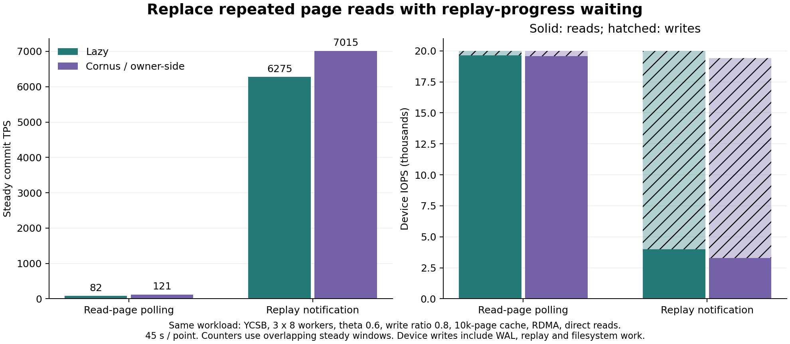
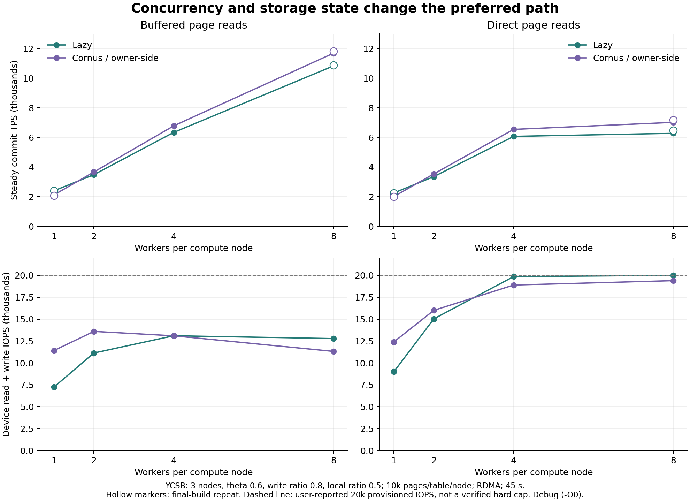
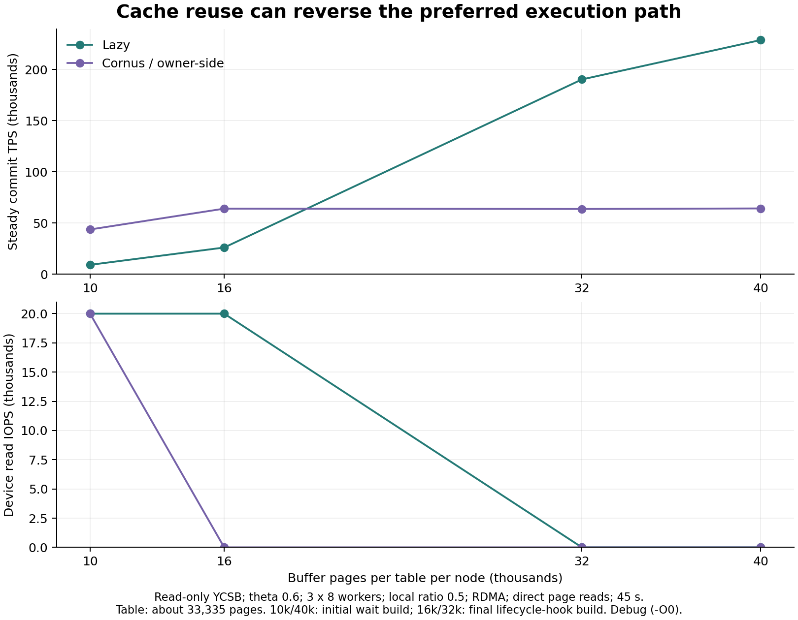

# 回放进度等待与事务处理成本边界（2026-11-06）

这轮先修复含写 Direct I/O 实验中的读盘轮询，再用相同配置比较执行、提交和存储资源需求。
研究方向仍是 [共享存储事务处理的成本模型](SHARED_STORAGE_COST_BOUNDARIES.md)，没有改变混合选择器、提交协议或刷盘参数。
此前异常结果及原始记录保留在 [2026-11-05 Direct I/O 实验](DIRECT_IO_COST_BOUNDARIES_20261105.md)。

## 本轮最重要的边界

- 读盘轮询是实现干扰。等待回放进度消除了大量重复读；含写小缓存 direct 的事务推进恢复，但真实的回放等待和混合 IO 代价仍在。
- 并发和提交机制会改变胜负。低并发 Lazy 的提交优势占主导；高并发 Cornus 的执行收益可以超过提交增量。保留决议日志的普通 2PC 又可能落在 Lazy 后面。
- 缓存复用与副本占用必须一起计价。只读小缓存时 owner-side 占优，容量足够时 Lazy 本地副本复用占优；中间容量对照用于缩小反转范围。
- 失败路径和资源排队不能忽略。热点下回滚比例接近，但失败尝试的耗时不同；饱和 direct 场景中，提交节奏变化也伴随执行等待变化。

这些是用于约束模型的静态对照，尚未实现新的在线选择策略，也不是优化构建下的峰值性能结论。

## 实现与正确性边界

旧的 GetPageWithLsn 路径反复读取 4096 字节整页，检查页面 LSN，版本不足时 sleep 10 μs 再读。
Direct I/O 下重试会再次进入设备路径，争用回放写入所需的 IO 和文件系统资源。

现在两种执行方式共用同一路径：

1. 按 `(table, page)` 查找回放进度；首次使用从文件页头初始化，仅缓存版本元数据，不缓存页面内容。
2. 版本不足时通过 bthread 条件变量等待，释放 RPC worker；注册、条件检查和通知使用同一把页状态锁。
3. 数据和页头写入完成之后发布该页 LSN，再读取一次整页并校验返回版本。版本不满足直接报错，不重新轮询掩盖问题。
4. 重启重新从文件初始化；直接 WritePage 和已有 undo 写入也更新进度。清零页重置进度，删表清除旧元数据。

等待的是**数据已经回放且对读取可见**，不是 WAL 已持久化。
日志跨节点到达顺序仍由原有 page prev_lsn 链控制；不会用某个节点的 WAL 最大 LSN 代替页面进度。
数据页完成 pwrite 不等于数据页已 fdatasync；WAL 持久化与页面可见性的职责仍然分开。
页状态元数据随访问页数增长，表删除或进程退出释放；它不计入计算节点的数据页缓存容量。
表删除/重建沿用原有排除并发访问的要求，本轮不实现并发 DDL 或新恢复协议。

没有新增等待超时、轮询间隔或线程数配置。stats.log 的 storage_page_reads 增加 replay_waits/replay_wait_s；
旧结果仍按已有 lsn_retries 展示，summary_human.txt 和原始节点统计不改写。
read_total_s 是实际整页读调用累计时间；replay_wait_s 是等待页面回放的累计时间。
二者均可跨请求重叠，且已包含在计算节点的取页等待中，不能再加到事务执行时间上。

## 实验口径

3 个计算节点、1 个存储及 remote 节点，RDMA、NO_WAIT、generate_log=1，每点 45 秒。
主矩阵 YCSB θ=0.6、write_ratio=0.8、local_ratio=0.5；缓存为每表每节点 10000/40000 页，worker 为每节点 1/2/4/8。
沿用固定独立 worker RNG、原数据规模、-O0 -DDEBUG 构建；log_flush_interval_ms=3、log_flush_batch_trigger=16，不改变主动同步请求的立即唤醒规则。
没有调整云盘、线程池或 OS 参数。Cornus 指 two_pc_variant=2pc-cornus：取消协调者决议日志，未启用存储直通知的 2pc-cornus-opt。
普通 2PC 保留决议日志；本轮不宣称实现完整 Cornus 故障恢复。
IO 开关只影响 RPC 整页读取；WAL、页头读取和回放写入仍沿用 buffered 路径。

下面执行和提交按全程成功事务计算；失败路径、按尝试均值、各提交路径及细项都保存在 metrics.json 和 stats.log。
TPS/设备指标使用截取窗口，不能与全程计时直接套用吞吐—延迟关系；旧版 direct 的吞吐持续变化时尤其如此。
“稳态”沿用去掉前 6 秒和末端的统计窗口，并不证明所有组合已完全预热；另保留末约 15 秒窗口检查持续变化。
三个节点没有严格全局起跑屏障，设备计数使用其窗口交集。全程计数不能直接除以稳态窗口长度。
当前云盘 20000 预配置 IOPS 来自用户说明，用户未配置 Burst IO；本轮未查询云 API，不能把参考线当作已验证的硬限额。
设备写请求包含 WAL、数据回放和文件系统工作，不等于日志条数、fdatasync 次数或物理介质操作数。

## 同配置修复前后

| case | 模式 | IO | 缓存页 | worker | 稳态 TPS | 全程 TPS | 成功执行 ms | 成功提交 ms | 读/写 IOPS |
|---|---|---|---|---|---|---|---|---|---|
| before/001 | Lazy | buffered | 10000 | 8 | 10920 | 10903 | 0.932 | 1.171 | 0/13319 |
| before/002 | Cornus | direct | 10000 | 8 | 121 | 441 | 26.148 | 28.010 | 19585/415 |
| before/003 | Lazy | direct | 10000 | 8 | 82 | 402 | 39.059 | 24.497 | 19621/378 |
| before/004 | Cornus | buffered | 10000 | 8 | 11826 | 11805 | 0.398 | 1.526 | 0/11510 |
| after/001 | Cornus | buffered | 10000 | 8 | 11682 | 11657 | 0.400 | 1.549 | 0/11324 |
| after/002 | Lazy | direct | 10000 | 8 | 6275 | 6351 | 2.407 | 1.234 | 3990/16011 |
| after/003 | Cornus | direct | 10000 | 8 | 7015 | 7074 | 1.850 | 1.389 | 3303/16094 |
| after/004 | Lazy | buffered | 10000 | 8 | 10822 | 10812 | 0.934 | 1.186 | 0/12789 |

旧版含写小缓存 direct 的绝大多数整页读取是版本重试。新版本把等待移出读盘路径，
总设备 IO 即使仍接近 2 万，工作组成也从大量重读转成实际读页和写入，事务进度恢复。
buffered 对照变化较小，说明这轮巨大收益集中在之前的读盘轮询干扰，不能作为协议本身的性能提升宣传。

| 模式 | 旧版整页读 | 旧版重试占比 | 新版整页读 | 新版回放等待次数 | 新版累计等待 s |
|---|---|---|---|---|---|
| Lazy | 1013604 | 96.65% | 205111 | 5676 | 383.16 |
| Cornus | 935104 | 96.37% | 174588 | 6597 | 420.71 |

回放等待和混合 IO 的代价尚未消失。最终读仍可能等待 buffered 脏页写回；新版本内核栈采样仍能看到
文件系统写锁/页等待。此次实验证明重复读放大被消除，不证明所有剩余等待都来自云盘限流。

## 并发边界：执行优势与提交代价一起变化

小缓存含写扫描：

| case | 模式 | IO | 缓存页 | worker | 稳态 TPS | 成功执行 ms | 成功提交 ms | 读/写 IOPS |
|---|---|---|---|---|---|---|---|---|
| scaling/004 | Cornus | buffered | 10000 | 1 | 2119 | 0.366 | 1.039 | 0/11419 |
| scaling/001 | Lazy | buffered | 10000 | 1 | 2395 | 0.679 | 0.553 | 0/7249 |
| scaling/005 | Cornus | buffered | 10000 | 2 | 3665 | 0.365 | 1.241 | 0/13603 |
| scaling/008 | Lazy | buffered | 10000 | 2 | 3487 | 0.730 | 0.958 | 0/11139 |
| scaling/012 | Cornus | buffered | 10000 | 4 | 6779 | 0.374 | 1.341 | 0/13102 |
| scaling/009 | Lazy | buffered | 10000 | 4 | 6338 | 0.792 | 1.050 | 0/13108 |
| after/001 | Cornus | buffered | 10000 | 8 | 11682 | 0.400 | 1.549 | 0/11324 |
| after/004 | Lazy | buffered | 10000 | 8 | 10822 | 0.934 | 1.186 | 0/12789 |
| scaling/002 | Cornus | direct | 10000 | 1 | 2007 | 0.490 | 1.037 | 943/11461 |
| scaling/003 | Lazy | direct | 10000 | 1 | 2252 | 0.815 | 0.538 | 1307/7691 |
| scaling/007 | Cornus | direct | 10000 | 2 | 3537 | 0.475 | 1.222 | 1627/14379 |
| scaling/006 | Lazy | direct | 10000 | 2 | 3351 | 0.851 | 0.938 | 1954/13081 |
| scaling/010 | Cornus | direct | 10000 | 4 | 6541 | 0.477 | 1.321 | 3048/15849 |
| scaling/011 | Lazy | direct | 10000 | 4 | 6069 | 0.905 | 1.042 | 3554/16309 |
| after/003 | Cornus | direct | 10000 | 8 | 7015 | 1.850 | 1.389 | 3303/16094 |
| after/002 | Lazy | direct | 10000 | 8 | 6275 | 2.407 | 1.234 | 3990/16011 |

低并发时 Lazy 较低的提交成本可以抵消较高的执行成本；扩大并发后 Cornus 的执行优势开始占优。
这个反转在 buffered 下也出现，不能全部解释成 Direct I/O 或设备读饱和。
含写 direct 小缓存在高并发开始出现明显回放等待和执行膨胀；判断代价必须同时看吞吐、IO 需求和等待位置。

下面的同步次数是全程 fdatasync 总数 / 成功事务数，不是单个事务的协议轮数：

| worker | 模式 | fdatasync/成功事务 | 平均 fdatasync ms | WAL KiB/成功事务 | 成功提交 ms |
|---|---|---|---|---|---|
| 1 | Lazy | 1.019 | 0.378 | 10.21 | 0.553 |
| 1 | Cornus | 1.965 | 0.402 | 14.45 | 1.039 |
| 2 | Lazy | 1.106 | 0.403 | 10.22 | 0.958 |
| 2 | Cornus | 1.251 | 0.475 | 14.49 | 1.241 |
| 4 | Lazy | 0.717 | 0.472 | 10.25 | 1.050 |
| 4 | Cornus | 0.648 | 0.495 | 14.54 | 1.341 |
| 8 | Lazy | 0.401 | 0.523 | 10.31 | 1.186 |
| 8 | Cornus | 0.324 | 0.491 | 14.63 | 1.549 |

Cornus 的 WAL 字节仍较多，但并发批量合并使其每成功事务的同步次数下降。
该统计也包含失败尝试及参与者产生的日志，不能当作一次成功事务的固定 IO 配方。
更多参与者既影响等待最慢必要日志的关键路径，也改变全局批量大小、请求量和排队；模型中的提交增量不能固定成一个常数。

## 缓存与负载对照

大缓存的含写扫描见原始 scaling/013–028；以下列出只读、热点和 SmallBank 控制组：

| case | 负载 | 模式 | IO | 缓存页 | worker | 稳态 TPS | 成功执行 ms | 成功提交 ms | 读/写 IOPS |
|---|---|---|---|---|---|---|---|---|---|
| controls/001 | ycsb 只读 θ0.6 | Lazy | buffered | 10000 | 8 | 27394 | 0.857 | 0.002 | 0/4 |
| controls/002 | ycsb 只读 θ0.6 | Cornus | direct | 10000 | 8 | 43667 | 0.538 | 0.001 | 19998/3 |
| controls/003 | ycsb 只读 θ0.6 | Lazy | direct | 10000 | 8 | 9122 | 2.590 | 0.002 | 19997/2 |
| controls/004 | ycsb 只读 θ0.6 | Cornus | buffered | 10000 | 8 | 58101 | 0.400 | 0.002 | 0/3 |
| controls/005 | ycsb 只读 θ0.6 | Lazy | buffered | 40000 | 8 | 229030 | 0.092 | 0.002 | 0/6 |
| controls/006 | ycsb 只读 θ0.6 | Cornus | direct | 40000 | 8 | 64232 | 0.364 | 0.001 | 0/11 |
| controls/007 | ycsb 只读 θ0.6 | Lazy | direct | 40000 | 8 | 228766 | 0.093 | 0.002 | 0/9 |
| controls/008 | ycsb 只读 θ0.6 | Cornus | buffered | 40000 | 8 | 64211 | 0.362 | 0.001 | 0/3 |
| controls/009 | ycsb 写80% θ0.95 | Lazy | buffered | 40000 | 8 | 3274 | 1.899 | 1.647 | 0/13957 |
| controls/010 | ycsb 写80% θ0.95 | Cornus | direct | 40000 | 8 | 7347 | 0.358 | 1.394 | 18/12969 |
| controls/011 | ycsb 写80% θ0.95 | Lazy | direct | 40000 | 8 | 3301 | 1.915 | 1.640 | 109/13463 |
| controls/012 | ycsb 写80% θ0.95 | Cornus | buffered | 40000 | 8 | 7351 | 0.340 | 1.394 | 0/12771 |
| controls/013 | smallbank 写80% | Lazy | buffered | 10000 | 8 | 29357 | 0.176 | 0.635 | 0/15502 |
| controls/014 | smallbank 写80% | Cornus | direct | 10000 | 8 | 27968 | 0.096 | 0.760 | 0.11/14798 |
| controls/015 | smallbank 写80% | Lazy | direct | 10000 | 8 | 29326 | 0.179 | 0.636 | 0.11/15496 |
| controls/016 | smallbank 写80% | Cornus | buffered | 10000 | 8 | 27953 | 0.093 | 0.762 | 0/14783 |

热点下两边失败比例接近，失败尝试的时间成本却不同；失败率本身不足以描述重试代价：

| 模式 | 失败比例 % | 失败尝试平均总 ms | 提交重取页 ms/attempt | 淘汰页数 |
|---|---|---|---|---|
| Lazy | 52.08 | 3.452 | 0.323 | 0 |
| Cornus | 51.92 | 1.389 | 0.002 | 0 |

提交重取页是按尝试摊分的诊断细项，不能从按成功事务计算的提交均值直接相减。这里还没有用消融实验将差距逐项归因到锁、权限迁移或 RPC。

只读 Direct I/O 中间缓存容量（每表每节点）补测：

| case | 模式 | IO | 缓存页 | worker | 稳态 TPS | 成功执行 ms | 成功提交 ms | 读/写 IOPS |
|---|---|---|---|---|---|---|---|---|
| capacity/001 | Lazy | direct | 16000 | 8 | 26043 | 0.907 | 0.002 | 19998/2 |
| capacity/002 | Cornus | direct | 16000 | 8 | 64039 | 0.365 | 0.001 | 0/4 |
| capacity/003 | Lazy | direct | 32000 | 8 | 190257 | 0.113 | 0.002 | 0.22/6 |
| capacity/004 | Cornus | direct | 32000 | 8 | 63711 | 0.380 | 0.001 | 0/3 |

16000 页时 owner-side 已没有淘汰和稳态设备读，约 6.4 万 TPS；Lazy 仍受缺页影响，约 2.6 万 TPS。32000 页时 Lazy 升到约 19.0 万 TPS，超过 owner-side 的约 6.4 万；本轮只将只读反转范围缩到这两个实测容量之间，没有精确定位阈值。
32000 页的 Lazy 全程仍淘汰 533487 页，但稳态存储读仅约 0.22 IOPS。每尝试远端计算节点取页约 0.071 次，存储业务页读取约 0.0039 次（后者包含启动取页）。这里 Direct I/O 已启用，不能再用存储 OS page cache 解释近零读；证据支持其他计算节点缓存承接剩余缺页。本地缺页、远端缓存命中和集群整体缺页必须分开建模。

只读时两种模式都不执行多写者原子提交；表中 Cornus 此时主要表示 owner-side 执行路径。
小缓存读需求与大缓存副本复用的优劣要分开解释，不能把只读结果归功于提交协议。
热点和 SmallBank 用来检查“缓存容得下后还有没有执行/提交差异”，不以总 TPS 代替各阶段分析。
大缓存低并发的 45 秒窗口仍可能含少量冷页读取；按末段窗口和淘汰计数判断，不笼统声称所有大缓存点都零读。

## 普通 2PC 对照与复验

| case | 模式 | IO | 缓存页 | worker | 稳态 TPS | 成功执行 ms | 成功提交 ms | 读/写 IOPS |
|---|---|---|---|---|---|---|---|---|
| twopc/001 | 2PC | direct | 10000 | 2 | 2927 | 0.483 | 1.572 | 1348/15004 |
| twopc/002 | 2PC | buffered | 10000 | 2 | 3028 | 0.369 | 1.581 | 0/14101 |
| twopc/003 | 2PC | direct | 10000 | 8 | 7108 | 1.316 | 1.907 | 3374/16267 |
| twopc/004 | 2PC | buffered | 10000 | 8 | 9511 | 0.390 | 2.016 | 0/12374 |
| twopc/005 | 2PC | direct | 40000 | 2 | 3063 | 0.382 | 1.590 | 58/13658 |
| twopc/006 | 2PC | buffered | 40000 | 2 | 3078 | 0.327 | 1.596 | 0/13685 |
| twopc/007 | 2PC | direct | 40000 | 8 | 9738 | 0.367 | 2.007 | 0.11/12576 |
| twopc/008 | 2PC | buffered | 40000 | 8 | 9685 | 0.346 | 2.016 | 0/12504 |

配对的多写者提交路径（只在该路径内计算均值）：

| worker | 缓存页 | IO | 2PC 多写提交 ms | Cornus 多写提交 ms | 2PC 决议日志等待 ms |
|---|---|---|---|---|---|
| 2 | 10000 | direct | 2.137 | 1.388 | 0.785 |
| 2 | 10000 | buffered | 2.149 | 1.397 | 0.797 |
| 8 | 10000 | direct | 2.689 | 1.600 | 1.118 |
| 8 | 10000 | buffered | 2.831 | 1.761 | 1.185 |
| 2 | 40000 | direct | 2.136 | 1.411 | 0.788 |
| 2 | 40000 | buffered | 2.145 | 1.418 | 0.793 |
| 8 | 40000 | direct | 2.790 | 1.711 | 1.168 |
| 8 | 40000 | buffered | 2.802 | 1.715 | 1.173 |

小缓存 direct、8 worker 的 2PC 与 Cornus 吞吐接近，但阶段成本不同：普通 2PC 提交更慢、执行反而更短。其存储累计回放等待也更少。低并发的执行时间则接近，差异主要在提交。此结果支持提交节奏与取页/回放排队相互影响的解释，不能把执行成本当作与提交无关的固定常数；目前还没有独立消融证明每一部分的因果贡献。

上述普通 2PC 点与 after/scaling 中同线程、同缓存、同 IO 的 Lazy/Cornus 配对；没有改变执行负载。
2PC 与 Cornus 共用代执行方式，协议成本需对照单写和多写路径，不能把所有差距都归因于执行。
关键的 1/8 worker、小缓存、buffered/direct 两模式再做一次复验：

| case | 模式 | IO | 缓存页 | worker | 稳态 TPS | 成功执行 ms | 成功提交 ms | 读/写 IOPS |
|---|---|---|---|---|---|---|---|---|
| repeat/001 | Cornus | direct | 10000 | 8 | 7184 | 1.820 | 1.356 | 3392/16493 |
| repeat/002 | Lazy | buffered | 10000 | 8 | 10876 | 0.932 | 1.177 | 0/13189 |
| repeat/003 | Cornus | buffered | 10000 | 8 | 11813 | 0.400 | 1.527 | 0/11812 |
| repeat/004 | Lazy | direct | 10000 | 8 | 6481 | 2.308 | 1.207 | 4112/15887 |
| repeat/005 | Cornus | direct | 10000 | 1 | 2006 | 0.492 | 1.037 | 940/11459 |
| repeat/006 | Lazy | buffered | 10000 | 1 | 2409 | 0.683 | 0.543 | 0/7279 |
| repeat/007 | Cornus | buffered | 10000 | 1 | 2085 | 0.371 | 1.057 | 0/11236 |
| repeat/008 | Lazy | direct | 10000 | 1 | 2249 | 0.817 | 0.539 | 1302/7685 |

另补全本地负载（local_ratio=1，40000 页，buffered），用于区分本地路径自身成本与远端参与负载的干扰：

| case | 模式 | IO | 缓存页 | worker | 稳态 TPS | 成功执行 ms | 成功提交 ms | 读/写 IOPS |
|---|---|---|---|---|---|---|---|---|
| locality/001 | Cornus | buffered | 40000 | 1 | 4464 | 0.067 | 0.592 | 0/13568 |
| locality/002 | Lazy | buffered | 40000 | 1 | 4492 | 0.062 | 0.592 | 0/13663 |
| locality/003 | Cornus | buffered | 40000 | 8 | 17104 | 0.104 | 1.233 | 0/13110 |
| locality/004 | Lazy | buffered | 40000 | 8 | 17151 | 0.097 | 1.242 | 0/13103 |

全本地、1 worker 时两种模式成功提交均约 0.59 ms，执行也接近。这说明混合负载中 Cornus 单本地写路径的较高等待不能仅归因于模式名称或一个固定协议轮数；远端参与事务带来的并发工作和资源状态也需要考虑。该控制同时改变了远端访问与提交参与情况，不单独证明其中某一个因素的贡献。

本轮复验用于检查方向及运行顺序敏感性，不是置信区间。下一阶段做论文图需要更多独立运行和统一优化构建。

## 对成本模型的约束

- **缓存状态改变每事务的资源需求。** 本地副本的当前获取成本、后续复用收益及挤出其他页面的机会成本要一起估计。
- **协议路径与批量状态共同决定提交代价。** 只读、单写、多写分别估计，但 Lazy 的 single_local 是提交归属，不能直接与 Cornus 的本地事务子集当成同一负载。
- **IO 需求与资源容量必须同时进入模型。** 两个执行方式都达到相似设备 IOPS，不代表 TPS 相同；每成功事务造成的读、写和字节需求可以不同。
- **分清关键路径和资源工作量。** 参与者 prepare 等待总和、回放等待总和不能与 home 的提交时间重复相加。
- **参数随并发和环境改变。** 当前模型应该吸收局部性、批量合并和资源排队变化，不能用一次测量的远端 RPC/flush 常数套全部场景。

下一步优先用这些静态对照做离线选择预测，检查模型是否能解释已观察到的胜负反转，再做运行时选择。
先验证缓存容量、并发和热点这些明确边界；不要把优化读轮询获得的收益当成 hybrid 的贡献。
对 buffered write/direct read 的进一步存储设计、不同文件系统/盘、优化构建和更长稳态测量另做受控对照。

## 验证与复现

真实构建三个服务并核对四台机器的源码/二进制。功能验证直接链接本项目 LogReplay/LogManager/DiskManager 和 bRPC：
33 个等待 bthread、4 个 worker；先持久化后继日志，确认页面等待不会因 WAL durable 而放行；
另一页可独立完成，补齐前驱后唤醒；64 次通知/注册交错；读取实际内容及 LSN；清零页重置；重启从文件初始化。
最终版本把通知放到实际页写入之后，并补齐页面/表生命周期钩子；复验和普通 2PC 使用最终版本。
这些检查不替代完整 SQL/故障注入验证，临时探针和分析脚本随结果归档，没有增加仓库根目录测试脚本。

服务器结果：`/data/workspace/Hybrid_Cloud_MP/result/replay_wait_study_20261106`。
本地副本：`result/replay_wait_study_20261106`。每点包含 study_trial.json、有效配置、node*/result.txt/tps.log、
stats.log、存储统计和四节点每秒资源采样。metrics.json 为派生结果，保留完整原始数据及分析程序。

最终校验：76 次运行、228 份节点结果、70,148,092 次尝试、68,714,611 次成功。
事务数、提交路径及日志等待分类总和对齐；实际 O_DIRECT 描述符与配置一致，读取字节与调用数对齐；WAL 全部读完且无待接续日志；四机 RDMA 限速丢包为零。
存储完整页读与计算业务页快照不是同一口径：计算端仅为 table_id < 10000 的业务表计数，元信息表不计入，且快照早于存储最终统计。本轮差额按负载为 ycsb 536–538 页；smallbank 3575 页。保留这些差额，不宣称是逐请求的精确恒等式；IO 需求分析使用存储端实际读计数。

源码指纹（阶段内一致；原始结果不跨版本混写）：

| 阶段 | 指纹 |
|---|---|
| before | 34599621eccd0a9c7b1cabb9880043355e3b1142d117555cac00c27d05a23746 |
| after / scaling / controls | a2fb3adb0a39b395f1f23c389d8b058c196f53a41c300576a247c212cc003cf8 |
| repeat / twopc / locality / capacity | bfd55123d8949d5afed97e690987490e3bce00cefa585a226bc447b5777c5c04 |
