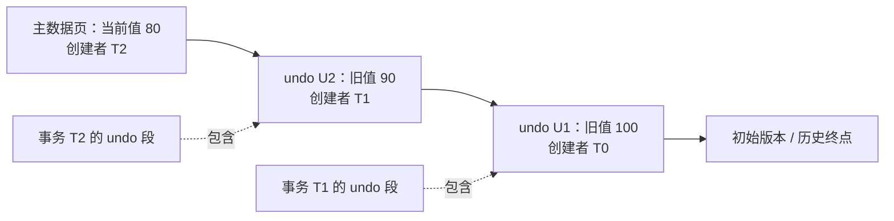

# Undo 与 MVCC 上层设计（上层方案已确认）

上层设计确认日期：2026-11-17；实施状态同步：2026-11-19。原始源码基线为 `09fed8e`，实现位于该基线之上的未提交改动中。本文保留已确认语义、职责、流程和正确性条件；原系统现状及 C 类引用按基线理解，不能当成当前工作区仍未改造。实施状态集中说明如下，D1—D9 不变。

实施拆分、阶段验收及用户要求的 assert/CHECK 编码风格见 [分阶段落地计划](/Users/noctis/Documents/项目/Hybrid_Cloud_MP/doc/UNDO_MVCC_IMPLEMENTATION_PLAN_20261117.md)；接续工作的独立上下文见 [新窗口提示词](/Users/noctis/Documents/项目/Hybrid_Cloud_MP/doc/UNDO_MVCC_NEW_CHAT_PROMPT_20261117.md)。这些文档不改变已确认语义。当前 P0/P1 基础、P2 存储、P3 单节点 Lazy、P4 两节点 Lazy、P5 2PC/mix/Cornus 正常运行路径及 P7 当前范围整体验收已有源码接入并在 AliYun1 实际运行。`mvcc_epoch` 现支持显式 16 字节或由 remote_server 启动时随机生成并共享，用户无需手动设置。P7 的矩阵、命令、性能和未验证项见 [P7 验收报告](UNDO_MVCC_P7_ACCEPTANCE.md)；实际状态以 [实施交接](UNDO_MVCC_IMPLEMENTATION_PROGRESS.md) 顶部为准。跨物理机、3+ 节点、HA 和完整故障恢复仍未验证。

2026-11-19 范围调整：当前版本只追加、保留全部 undo 历史及可见性所需的事务终态，不执行 GC、链截断或 undo 页/槽复用。P5 后直接进入 P7 正确性验收，P7 当前范围已完成；原 P6 回收方案保留为以后可选的空间优化，不是本轮完成 MVCC 的条件。容量耗尽时必须明确拒绝新写并保留在途事务的完成/回滚资源，不能覆盖旧历史；长期保留会增加磁盘占用，可能影响历史读取和回放成本。第 11 节的回收规则仅供未来启用 GC 时使用。

用户已确认 D1—D9 按本文方案执行：D1 事务级快照隔离；D2 固定 snapshot_scn，以事务提交状态和 commit_scn 判断可见性，提交时完成集群同步；D3 逻辑段按需分配物理页、2PC 各写节点管理子段；D4 保存完整逻辑旧行，每次实际覆盖保留 undo，首版不合并；D5 保留 Lazy 执行更新时写共享行、2PC Commit 时写共享行的差异；D6 覆盖 Lazy、2PC、mix；D7 为 undo 生成 redo，由存储端回放写页，不扩展高可用或完整事务故障恢复工程；D8 独立可配置缓冲池，初始每节点 10,000 页，保护长快照；D9 覆盖现有负载实际操作，不额外扩展通用数据库功能。SCN 并发分配和发布已细化为 [SCN 协议](SCN_MVCC_PROTOCOL.md) 的统一编号、全员 Stage/Advance 两轮确认；P4 已用固定协调点（节点 0）和两节点成员接入真实 Lazy。页格式和原 LPLM/GPLM 接入见 [Undo 存储协议](UNDO_STORAGE_PROTOCOL.md)，真实单节点路径见 [P3 说明](LAZY_MVCC_P3.md)，多节点状态见实施交接。

当前方案是：**主数据页原地保存当前版本，旧版本写入独立管理的 undo 页；事务开始时固定 snapshot_scn，按创建事务的提交状态及 commit_scn 沿链找到可见版本；undo redo 与主数据 redo 共用实际写节点的 WAL、批量刷新和持久化等待。** 写事务成功返回前满足所需日志持久化、全事务写入完成及 SCN 同步条件，已有事务的快照不随广播改变。

Oracle RAC 调研后的结论：**全局一致性不要求每笔事务必须向中心单独取号。** 原来的“Begin 保存全局活跃事务集合”方案不再作为本轮可见性规则；集中服务的性能比较保留为研究背景。SCN 协同、提交传播和历史副本的依据及适用边界见 [RAC 调研](/Users/noctis/Documents/项目/Hybrid_Cloud_MP/doc/ORACLE_RAC_MVCC_RESEARCH_20261117.md)。

这里的“单版本”指主数据页只放一份当前行，逻辑上仍然存在多个可读版本。用户提出的方向成立，但需要把顺序明确为“先保存旧版本，再覆盖当前行”，并补上事务状态、跨节点可见性、回滚和历史回收四部分。

## 1. 范围和当前事实

整个分阶段任务最终覆盖 YCSB、SmallBank、TPC-C 和 Lazy、2PC、mix；P5 已完成 2PC/mix/Cornus 正常运行路径，P7 已完成当前范围验收；P6 的 GC、页复用和完整恢复延期。所有接入的访问路径使用相同的可见性规则，不能只有 Lazy 的本地读能读历史，而 2PC 远端读仍返回最新值。SQL 不在本次范围内。2PC 现有变体及 mix 的接入差异见第 8 节，不扩展 mix 调度策略。日志工作聚焦 undo 页及相关历史引用的 redo 与回放，具体范围见第 10 节。

以下是设计制定时从 `09fed8e` 确认的基线事实；单节点 Lazy 中的空历史读取、旧快照及回滚入口已经在 P3 替换，其他模式仍需按阶段接入：

| 原始基线事实 | 对方案的影响 |
|---|---|
| 只读入口有 `start_ts < version` 判断，但 `UndoDataItem` 直接返回原记录；2PC 远端读取也没有真正重建历史 | 需要建立统一的历史读取语义，不能只补一个旧值容器。[C1] |
| 开始和提交时间戳来自批量领取的号段，之后在本地消耗；时间戳服务重启后计数重新开始 | 当前数值不保证跨节点实际发生顺序，也没有持久化的重启身份，不能直接承担新的快照正确性。[C2] |
| Lazy 的更新回调在执行过程中覆盖共享缓冲页的行；2PC 的回调先修改 home 私有副本，参与者在 Commit 覆盖共享行 | undo 的产生必须跟实际覆盖时机对应；2PC 可在 Prepare 阶段准备 undo，见 D5。[C3] |
| Lazy 已有延迟清锁和 home 内存事务终态表 | 可以保留“提交不逐页清锁”的目标，正常运行时的提交可见性必须全事务一致；终态故障重建不作为本轮独立工程。[C4] |
| Commit 和 Abort 当前都使用 `BatchEndLogRecord`；存储回放对 BATCHEND、PREPARED 仅消费元数据 | undo redo 不会自动补齐事务终态恢复；该现状作为后续完整恢复的依赖记录，不扩大本轮范围。[C5] |
| WAL 按计算节点分别存放，存储回放使用每页前驱 LSN 依赖 | “共用日志流”是共用各实际写节点已有的流；跨流依赖不能用一个裸 LSN 大小替代。[C6] |

旧设计文档曾明确保留模拟快照读，那是前一轮改造的范围限制。本次用户已明确要求真实 undo/MVCC，本文据此讨论所需的语义变化。

## 2. 版本、事务和 undo 段的关系

每个主表记录保存当前业务值、这个版本的创建事务身份、删除状态，以及指向前一个版本的稳定 undo 引用。undo 记录保存足以重建前一版本的信息，包括旧业务值、旧版本创建者、旧删除状态、前一版本的 undo 引用和记录身份。

**版本创建者必须与当前锁持有者分开。** 某事务可能只取得写锁而尚未更新；锁也可能交接给下一事务。锁持有者变化不意味着业务版本变化。现有锁 owner 字段不能直接当作版本创建者使用；回滚旧值时也不能把旧锁持有者、等待队列或进程内指针一起恢复。

例如 T1 把 100 改为 90，它的 undo 段保存值 100；T2 再把 90 改为 80，它的 undo 段保存值 90。**一行的历史链会跨越多个事务的 undo 段。** 保存旧版本的 undo 记录属于“覆盖它的事务”，旧版本本身的创建者则是另一个概念。

还需要两种逻辑遍历关系：行的历史链用于快照读；事务的修改顺序用于逆序回滚。不能拿一条行历史链代替整笔事务的回滚记录。

已确认先保存完整旧行的逻辑内容。字段增量压缩可以以后优化。重复更新按以下方式组织：一个事务多次实际覆盖同一行，每次覆盖保留一条 undo，首版不合并，完整回滚按相反顺序执行；尚未写入主数据页的私有副本修改不必每次都生成持久 undo。这里的“完整逻辑行”不包括进程内指针、锁或等待队列。

## 3. undo 空间、页和缓冲池

按已确认的 D3，事务开始时分配**逻辑 undo 段身份和管理信息**；第一次需要保存旧值时再按需分配物理页，后续不足时扩展。这样保持“一事务一段”的使用方式，同时避免只读事务和小事务在 Begin 就预留大段磁盘或固定内存。段可由不连续的页组成，不要求一块预先定长的连续空间。

2PC 事务使用“一个全局逻辑段 + 各写参与者自己的子段”。哪个节点实际修改数据页，就在该节点管理的子段追加 undo，并进入该节点已有 WAL。强制把所有 undo 写到 home 会引入额外远端写入和跨节点持久化依赖，故不采用。子段是内部空间组织，不增加新的业务写参与者。

D3 的具体含义是：事务 T 在 Begin 时先建立“属于 T 的 undo 空间”这项管理记录，此时可以没有物理页；第一次更新才申请页，写满再申请下一页。只读事务不会因此占一页。若 T 通过 2PC 在 N1 修改 A、在 N2 修改 B，则 N1 保存 A 的旧值、N2 保存 B 的旧值，二者在管理上都属于 T。这不要求所有历史放在同一机器或一块连续空间，也不改变 undo 页可以被其他节点读取的规则。

undo 页使用与项目数据页一致的 4 KiB 粒度，复用页目录、S/X 权限、本地 latch、缓存、LRU 和淘汰机制。需要独立的页身份空间，容量可随 undo 空间增长；不能简单依赖当前“主表、BLink、FSM”三个编号区间和预分配页数。当前具体映射为 `UNDO_TABLE_ID=30000` 与 `(number-1)*100+writer+1` 的交错页号；完整 epoch/writer/number/generation 保留在页头及稳定引用中。由现有 GPLM/LPLM 管权限和取页，不再另设 undo 目录服务。

按已确认的 D8，当前配置项为 `undo_buffer_pool_size_pages`：**每个计算节点上所有事务、所有表共用的 undo 缓冲池总帧数**，独立于数据页、BLink、FSM 的预算。首个实验基准设为 10,000 页，纯页数据约 39.1 MiB，实际内存还包括管理开销；该数值是起始配置，需测量后调整。

另有 `undo_lock_table_initial_capacity`，默认 10000，只控制现有页锁表/有效性表预分配的页号范围，范围外按需建条目；与 undo 缓冲帧预算独立。原 `sparse_` 开关已去掉。当前 Manager 一次分配一张 4 KiB 页，Begin 不分配页；没有连续 100 页预分配。

| 对象 | 管理规则 |
|---|---|
| 正在追加的 undo 页 | 单个子段由对应写节点追加，持 X 权限修改；其他节点读取须取得一致的页视图 |
| 已发布的 undo 记录 | 业务历史内容保持不变，不能原地改写成另一条历史记录；链尾仅允许第 11 节所述的安全、日志化截断 |
| 已封口的 undo 页 | 不再追加，适合多个节点保留 S 副本；回收仍需撤销或失效旧副本 |
| 缓冲池中的 undo 帧 | 读写期间固定，使用结束后可进入替换器；缓存淘汰不删除历史 |
| 逻辑 undo 引用 | 可由任意节点定位到持有者或共享存储；含对象代次以区分页/槽复用，不是内存地址，也不能仅用裸 WAL LSN |

这里的页面权限代价，特指直接复用 Lazy 整页 S/X 协议时的情况。假设 undo 页 U 已经保存记录 u1，节点 A 还会继续向 U 追加 u2：

1. A 持有 U 的 X 权限，向其中追加记录。
2. 节点 B 为了读某行的旧版本，需要读取 U 中已经写好的 u1，于是申请 U 的 S 权限。
3. 整页协议不能同时让 A 保有独占 X、让 B 持有 S，因此需要权限交接和必要的页面传递。
4. A 随后要向同一个 U 追加 u2，就要重新取得 X，并撤销其他节点的 S 权限。

u1 本身没有变化，但权限保护的单位是整页，u1 的读和 u2 的追加会发生这种冲突。它只在实际有跨节点历史读取且页面仍继续追加时发生，不是每次读 undo 都必然迁移页面。页面交接如果仍有未持久化日志，还会触发已有的日志等待；日志已经持久化时，不必再为同一前缀刷新。

“封口”仅指决定不再向 U 追加，把新记录写入另一页；U 就适合保留多个只读副本。它不表示事务提交或立刻刷盘，过早封口也会浪费页内空间。首版先复用现有协议，不默认每条 undo 单独占一页；是否需要让读者只取得某条不可变记录、避免整页权限切换，留待测量后再决定。

空间使用必须区分：缓冲池容量限制内存，undo 保留量限制磁盘历史，单笔事务容量限制单个写者。缓存满应走正常淘汰；历史空间不足应限流或拒绝新的写入，不能覆盖仍被快照或恢复需要的记录。需预留足够的回滚资源，防止磁盘或缓存耗尽后连 Abort 都无法完成。

## 4. 已确认的 SCN 快照与提交同步方案

D2 已确认采用 SCN 判断可见性。普通事务 ID 只标识身份；快照 SCN 和提交 SCN 表达可见性顺序。三者不再混用。

| 概念 | 作用 |
|---|---|
| tx_id | 标识版本的创建事务；保证唯一，可保留适合身份分配的批量方式，不以大小判断先后 |
| snapshot_scn | Begin 时取得的有效快照边界，整个事务固定；多个事务可以取得同一边界 |
| commit_scn | 写事务的提交顺序位置，必须与提交状态联合判断，不等于自己的 snapshot_scn 加一 |
| WAL LSN | 某日志流或页面的持久化、回放进度，不代替 SCN |

已确认的隔离语义是事务级 SI。普通读看到本快照包含的已提交版本，自己的修改也可见；写同一行时仍执行元组互斥与快照写冲突检查。此方案不额外承诺可串行化。[R1]

### 4.1 事务生命周期

1. **Begin**：从按全局协议维护的可用边界取得 snapshot_scn，并保护这个快照所需的历史。目标是使用本地维护的有效边界，不要求每个事务专门向中心领一个唯一快照号。
2. **执行读写**：普通读始终使用原 snapshot_scn；发生写入也不改变它。自身已执行的修改可见。所有参与者和远端请求复用同一 snapshot_scn。
3. **只读结束**：解除历史保留需求，没有业务更新需要发布，不必为这次只读结束单独分配新的提交 SCN。
4. **写事务提交**：确定符合全局顺序的 commit_scn，完成协议要求的持久化和所有写项，向集群中需要同步的计算节点传播 SCN/提交进度。
5. **提交成功返回**：所需 WAL 等待、全事务可见性条件和集群同步确认均满足后返回。发送可以异步并发，事务不能只发出通知就报成功。SCN 同步确认不要求所有节点把相关数据页回放落盘。

广播推进节点供新事务使用的边界，不改变节点上已运行事务的 snapshot_scn。日志写入和 SCN 通信应尽量重叠；哪些阶段可并行由完整协议决定，不能把有先后依赖的步骤强行重叠。保留已有 WAL 刷新策略，不为广播通知单独增加每事务同步刷盘。

### 4.2 已讨论的例子

初始余额 100，已发布进度为 SCN=10。读事务 R 在 B 上开始，固定 snapshot_scn=10。写事务 W 在 A 上把余额改为 80，旧值 100 已保存到 undo。

W 提交前，R 通过 undo 读 100。假设 W 的 commit_scn=11，完成日志持久化和所需同步后提交成功：R 的快照仍是 10，所以继续读 100；随后在 B 上开始、取得快照 11 的新事务读 80。

如果 A 在 B 得知新进度前就返回提交成功，B 随后开始的事务可能仍取到 10，读出 100。这违反本方案“成功提交先于新事务开始，则新快照应包含该提交”的要求，因此选定提交等待同步的方向。

### 4.3 快照边界必须安全，不能直接使用收到的最大数字

版本判定采用“已提交且 commit_scn <= snapshot_scn”。这里把 snapshot_scn 定义为包含端点的可见边界，不能把现有 begin_ts 直接改名后套用。

该规则成立依赖以下约束：

- 一旦快照 S 已发给事务，就不能在它开始读后，再把原本不属于该快照的提交发布到 <=S 的范围，使重复读突然看到新版本。
- 已取到 commit_scn、仍在写入或等待日志的事务，不能仅凭这个编号就被当成已提交。
- 收到较大 SCN、提交决议成立、整笔事务可见、允许新快照推进，是需要协调的不同事件。广播确认的语义必须覆盖协议所需条件，不能等同于只把一个计数器取最大值。
- 已经成功返回的提交必须包含在之后的新快照中。SCN 广播、并发 Begin 和并发提交之间的具体顺序需在协议设计中证明。

这些条件现由 SCN 协议具体化：唯一 CommitCoordinator 分配连续提交位置；低位置未就绪时不发布高位置；先全员 Stage 安装终态，再全员 Advance 推进新快照边界，收齐 Advance ACK 才成功并允许交锁；允许 Abort 的已分配位置经回滚和终态发布填洞。Begin 在本地同一 mutex 内读取 safe_scn 并登记保护，不再重新选型。P4 LazyRuntime 已驱动两节点 Stage/Advance、Commit RPC 和跨节点 creator 状态；P5 已把普通 2PC、Cornus v1/v2 和 mix 接入同一发布协议。

快照开始使用前须建立历史保留保护；只读事务也不能绕过此步骤。本地登记与全局保留水位的汇报方式可以优化，但不能因此发生“快照已经开始、GC 却不知道”的窗口。

### 4.4 现有时间戳号段的处理

当前代码预先领取号段再本地消耗，数值不保证跨节点实际开始/提交顺序。[C2] 例如 B 以 450 开始后，A 才启动却以 206 提交，直接比较就会错误地让 B 看见 A。

因此，普通 tx_id 的批量分配可以保留；用于可见性的 SCN 必须按新协议维护。SCN 方案也不要求 Begin 保存一份全局活跃事务清单。活跃事务/快照仍会用于锁管理、事务状态和 GC，但不再作为独立的逐版本可见性过滤集合。

## 5. 历史读取，以及什么时候停止

读取先在数据页的短暂保护下复制“当前业务值 + 版本创建者 + 删除状态 + undo 引用”的一致组合，然后释放数据页保护。在事务私有内存中检查可见性；需要历史时逐页读取 undo 并重建候选版本，不修改共享的当前行。快照和正在进行的读取共同保证所需历史不会被回收。undo 构造历史行的基本用途可参考 InnoDB 的多版本说明。[R3]

候选版本的创建事务状态及 commit_scn 可从可靠的事务状态记录或等价的版本信息取得，不要求提交时重新获取所有数据页并逐行清锁。

按以下顺序判断：

1. 候选版本是本事务已经执行的更新：可见；2PC 尚未写入共享页时优先从本事务私有写集取值。
2. 候选来自初始化数据：作为已提交的初始版本，具有不晚于正常事务快照的初始 SCN。
3. 创建事务已经全局提交且 commit_scn <= snapshot_scn：可见。
4. 创建事务未提交、准备中、提交安装中、回滚中，或者已提交但 commit_scn > snapshot_scn：不可见，沿 undo 继续找前一版本。已回滚的候选也跳过。
5. 事务结果或所需 commit_scn 未知：先解析状态或明确失败，不猜测已提交，也不静默返回一个可能错误的更旧版本。若出现与第 4 节快照边界约束矛盾的状态，按一致性错误处理。

固定快照依赖第 4 节的提交发布规则。不能仅靠“当前状态已提交”补救一个在快照建立后才被追加入该快照范围的提交。

**停止点是“沿链遇到的第一个对本快照可见的版本”。** 若它是正常记录，返回其值；若它是已删除标记，返回“不存在”，不能继续向前找一个未删除版本把它复活。

合法到达“该行尚未创建”的终点时返回不存在。若链指向缺失页、代次不匹配、损坏记录，或本应保留的历史已被清除，应报历史读取/恢复错误，不能返回最新值兜底。对本设计允许的仍活跃快照，正常 GC 不应造成“历史太旧”。

普通快照读不等待另一个事务的行写锁，可通过 undo 绕过未提交版本；它仍可能等待页面权限、缓存缺页、存储回放和必要的事务状态解析。故“MVCC 读写不阻塞”不能解释为该项目中所有读都不会发生等待。

## 6. 更新、重复更新与回滚

一次实际覆盖主数据页应满足以下顺序约束：

1. 获得元组写锁，确认这个写入基于本事务可见的最新已提交版本；本事务自己的版本可以继续修改。
2. 为 undo 预留足够空间，保存旧业务值和旧版本元信息，形成完整的历史记录。
3. 将 undo 创建和当前行变化所需 redo 按依赖顺序加入同一实际写节点的 WAL。
4. 在数据页保护内把新值、新版本创建者和 undo 引用一起安装，使后续读取只能复制到更新前或更新后的完整状态。
5. 释放短期页面保护，事务写锁按事务生命周期继续保留。该更新本身不强制增加一次同步刷盘。

这里允许空间预留和日志组织采用不同实现，但不得在其他线程能看见新 undo 引用后才补旧值。也不能长期持有数据页 X 保护等待另一节点的 undo 页而形成反向等待；可在覆盖前预留资源，必要时释放页面保护、保留逻辑写锁并在重新取得页面后重检。

写入还需要**快照冲突规则**：如果本事务开始之后，另一事务已提交对同一行的修改，那么即使现在能获得写锁，也不能基于旧快照值覆盖它；应回滚并以新快照重试。若对方回滚，本事务可重检后继续。具体检查最新已提交版本的 commit_scn 是否晚于本事务 snapshot_scn；若晚于，则回滚重试。这执行已确认的 D1，不再把“普通读快照、写时读当前值”作为本轮候选。

同一事务把 100 改成 90 再改成 80 时，可形成两条 undo；自身读到 80，其他快照跳过这个事务的两个中间版本，直到找到可见的 100。整笔回滚逆序恢复旧值、版本创建者、删除状态和历史链头；锁和等待队列由当前事务控制流程收尾，不恢复历史锁字节。

正常运行中的事务回滚仍在 MVCC 范围内：按 undo 恢复主行，对这些主行变化继续生成 redo，只有撤销完成后才能发布 ABORTED 并释放对应的逻辑写约束。已有进程内旧值副本可以作为缓存，但不能代替 undo 页及其 redo。崩溃后如何识别并继续整笔未完成回滚，属于后续完整事务恢复工作，本轮不额外建设该流程。

## 7. 提交状态和延迟清锁

版本可见性、事务持久化结果和物理锁清理需要分别表达。上层状态至少能区分：正在执行、已准备但未决、已决定提交但仍在安装、已全局提交可见、正在回滚、已回滚、结果未知。

对单写节点的 Lazy 事务，已走更新回调的业务值和 undo 在执行时写入共享页；其余写回路径也必须在提交发布前完成。提交按已有流程等待相应 WAL 达到持久化位置，其中包括本事务的 undo 和主行 redo，并满足 SCN 协议的全局提交发布及同步确认条件；发布以后新快照可见，旧快照保持原边界。只有完成发布后才向客户端返回成功。日志等待和状态传播能否重叠，按 SCN 协议的阶段依赖确定。

可以继续延迟清理行上的物理锁标记，提交不必重新拉回所有数据页。后续访问者根据本次运行中一致的事务终态判断是否仍受该锁约束；补记状态只是优化，不应成为识别版本的唯一来源。本轮需要正常运行中的状态与全局可见性，故障后从日志恢复整张事务状态表留待后续。

版本上的事务身份不能与仍保留的历史发生冲突。方案建议使用运行代次配合代次内单调分配的事务号；涉及持久化的身份与空间信息也需有相应 redo，不能在回放时随意生成另一身份。身份与原有日志编号、锁等待时间戳的兼容关系留待实现设计，不把三者强行当作一个数值。

全局发布应与已有提交路径衔接，不为“发布通知”单独增加同步刷盘。若所需 SCN 确认未完成，不能提前报提交成功；若提交决议已不可撤销，也不能因广播超时就当作普通 Abort。故障后自动接管、旧事务结果解析和重新提供服务不在本轮范围内；undo redo 不等于已经具备这些能力。

## 8. Lazy、2PC、mix 的接入

D5 已确认保留现有写入时机。“安装”仅指**把事务算出的新值写进共享缓冲池中那条真正的记录**，不表示刷磁盘，也不表示提交或已对其他事务可见。以下以当前更新回调路径为例；仍使用旧写回路径的负载也必须接入 undo。

| 把余额 100 改为 90 | 执行 UPDATE 时 | 提交阶段 |
|---|---|---|
| 当前 Lazy 回调路径 | 共享数据页中的余额已经变成 90，事务尚未提交 | 完成提交持久化和状态发布；不必再次写这笔业务值 |
| 当前 2PC 回调路径 | home 的事务私有副本变成 90，参与者共享页中的余额仍为 100 | Commit 时参与者把共享页中的余额改成 90 |

接入 MVCC 后，Lazy 在执行 UPDATE、覆盖 100 前保存 undo；2PC 保留现有写回时机，在 Prepare 准备旧值和 undo，Commit 时再把新值和 undo 引用写进共享行。两种方式都只有在整笔事务统一发布后，才让新快照看到 90。按已确认的 D5，在各自实际覆盖之前接入 undo，并补齐统一可见性约束，不把两种执行流程改成相同。若 Lazy 已覆盖后回滚，需要用 undo 恢复共享行；若 2PC 在覆盖之前中止，未挂链 undo 作为待回收空间处理。

| 模式 | undo 产生及安装 | 全局可见性条件 |
|---|---|---|
| Lazy | 每次实际安装业务值前保存 undo；页面迁移不改变事务身份、版本创建者及逻辑 undo 引用 | undo 与主行 WAL 满足已有提交等待，并完成统一发布 |
| 2PC 单写节点 | 仍可保留单写快捷路径；实际安装前准备 undo | 同一套提交发布条件，不强制增加多参与者 Prepare |
| 普通多写 2PC | 各参与者在 Prepare 前/期间准备稳定 undo 和最终写集；保留 Commit 才安装业务值的时机 | 所有持久化 YES、持久化提交决议、所有参与者完成版本安装，再统一发布 |
| mix | 采用 Lazy 分支时遵守 Lazy 规则，采用 2PC 分支时遵守 2PC 规则；版本链、snapshot_scn、commit_scn 和 undo 引用含义相同 | 分支选择不改变快照语义；一条行历史可以包含两种分支产生的版本 |
| Cornus / 存储通知版本 | undo 和恢复所需信息纳入各参与者的持久化准备证据 | 依据该协议的完整提交证据确定结果；所有参与者安装完成后统一发布；AllPrepared 通知本身不等于可见 |

保留当前 2PC 的私有副本计算方式时，参与者在 Prepare 阶段把将要被覆盖的旧版本保存为 undo，并固定它的身份；Prepare 的持久化必须覆盖 undo、最终值及它们的对应关系。尚未覆盖主行时，这些 undo 可以暂时未挂到行上。若准备后回滚，它们是待回收空间；不能误当成已经应用过的数据更新去撤销。

当前 Prepared Commit 可在结束日志异步落盘前回复。[C7] 本轮至少保证 undo 的 redo 在现有 Prepare 等待中持久化，并把稳定 undo 引用与对应写项关联，后续主行 redo 记录同一引用。这样不需要为 undo 单独增加 Commit 刷盘。完整事务重启恢复如何利用 Prepare 和决议补齐尚未持久化的主行更新，仍是后续恢复层的工作，不因为新增 undo redo 就宣称已完成。

当前参与者在 Commit 中逐行安装并解锁，不应原样成为 MVCC 的完成条件。新方案先安装全部写项，继续把整笔事务视为未发布；所有参与者确认并满足 SCN 发布条件后统一发布 COMMITTED，再允许写锁交接或通过终态触发延迟解锁。其他事务在这之前仍可通过 undo 读取旧版本。

例如 T 同时修改 A、B 两个账户，A 已安装新值而 B 尚未安装。T 此时仍未全局提交，新快照边界不能提前包含它：读 A 沿 undo 得到旧值，读 B 得到旧值。T 的所有写项完成、所需持久化和同步条件满足并统一发布后，新快照才能包含其 commit_scn，读到两个新值；此前开始的旧快照保持不变。各参与者必须使用同一个事务结果和 commit_scn，不能各自提前标为已提交。

这是对现有提交完成和解锁时机的必要调整，会增加全局发布协调，可能延长元组锁持有时间。已确认的 D5 保留 2PC 在 Commit 阶段覆盖业务值，本轮不另做写入时机对齐。

2PC 内部若选择现有 Cornus 或存储通知变体，同样接入 undo、redo 和统一可见性。其现有完整故障恢复边界保持不变，不把投票决议恢复、失败重试或在线接管纳入本轮。[C8] D6 已确认覆盖 Lazy、2PC、mix，D7 已将日志工作限定为 undo redo 及相关回放。

## 9. WAL、刷新时机和跨页依赖

用户关于共用 WAL 的要求可以采用：undo 页分配/初始化、undo 追加、数据行和版本指针更新、正常回滚造成的页面变化、历史截断及页复用等持久化变化，都进入原有实际写节点的日志流；事务现有 Prepare、Commit、Abort 日志继续走原路径。undo 不另外开一条要求独立同步的日志链路，也不对每条 UPDATE 单独调用磁盘同步。

**undo 页文件由存储端回放 redo 来写，完全沿用本项目普通数据页的持久化方向。** 计算节点的 undo BufferPool 负责当前访问和缓存；计算节点不另设一条把 undo 脏页直接刷进最终文件的通路。当前普通数据页已有的回放写页和等 LSN 取页流程可作为接入基础。[C11]

以一条记录从 100 更新成 90 为例，计算节点先在 undo 缓冲页 U 中保存旧值 100，再把主行改成 90 并指向 U 中的记录。对应的 WAL 顺序覆盖 U 的必要初始化、旧值记录写入，以及主行新值和引用。存储端先按既有机制持久化 WAL，再由回放把 undo 内容写进 undo 页文件、把主行变化写进表文件；实际回放仍需遵守各页及跨页依赖。

因此有两个时点：undo redo 已持久化，就有重建这条历史的依据；undo 页回放到目标位置后，才能直接从存储页文件读到这条记录。提交不必等待所有页面回放完成。计算端淘汰 undo 帧时，确保所需 redo 已持久化并保留正确的定位与回放依赖后即可按既有协议淘汰，不需另写整页；下次从存储取页时等待该 undo 页达到所需 LSN。若可从持页计算节点取得，则继续走现有页面访问协议。

当前 P3 Lazy 启动要求开启 WAL；关闭日志不能作为本阶段可用配置。保留必要持久化和回放机制，但没有完整事务状态恢复或恢复后继续服务的承诺。

当前刷新机制的准确情况如下：

| 触发或等待点 | 当前行为 | 新设计原则 |
|---|---|---|
| 后台定时 | 当前配置为 3 ms 周期 | undo redo 共用原后台刷新 |
| 日志记录数量阈值 | 当前配置达到 16 条时唤醒 | 共用原触发机制；undo 增加记录可能使阈值更早达到 |
| Commit / Abort | 请求刷新目标 LSN 并等待 | 把相应 undo 和事务结果纳入同一次持久化依赖 |
| Prepare / 普通 2PC 决议 | 各自已有持久化等待 | undo 恢复证据纳入 Prepare；保留协议必需的屏障 |
| 数据页 Push / 所有权交接 | 脏数据页在传出前等待相关日志；可由调度器延后发送 | 必须连同页面新引用的 undo 依赖一起满足 |
| 页面淘汰 | Lazy 数据页淘汰已有日志等待；2PC 数据页路径并不完全相同 | undo 淘汰不能直接套用不等待的分支；最后副本消失前须确保可从存储恢复 |
| 退出排空 | 等待在途日志批次和最后一次刷新 | undo redo 一并排空 |

按当前实现，每计算节点一个 WAL 文件，计算端将多条日志合为 LogWrite 批次，存储端每个非空批次一次 fdatasync。没有存储端 Leader/Follower 汇集多个 LogWrite 请求的合并实现。undo Store::Sync 只在回放排空时同步派生页文件，不是每条记录或每次提交的同步入口。

因此，**可以保持相同的刷新策略和共享批次，但不能承诺相同的实际刷新次数或延迟。** undo 增加日志字节和记录数，也可能增加页面淘汰与转移。提交时等待 WAL，不要求所有 undo 数据页、主数据页都同步写入它们的最终文件。[C9]

每次覆盖必须满足两种依赖：

- 内存发布依赖：引用可被读取之前，完整 undo 记录已经存在，并有受保护的生命周期。
- 持久化/回放依赖：数据页的新引用被转出、淘汰或恢复后使用时，对应 undo 必须能从已持久化的日志或页面重建；读取历史需要等 undo 页自身的回放水位。

本地先生成 undo redo，再生成引用它的主行 redo，并置于同一 WAL 流，等待后者持久化就覆盖了前者。当前 P3 由一个回放线程按流内顺序同步应用，所以主行回放时用 CheckHistory 检查 undo 已完成，原历史等待队列已删除。**日志已落盘仍不等于 undo 页已回放**：读 RPC 可以先于回放线程到达，GetUndoPage 必须等待目标页/LSN。多文件回放没有跨流到达全序，普通主页面的前驱队列继续保留；P4 Lazy 的主行 redo 与 undo 仍同 writer；P5 已把“本事务创建新版本”的 redo 与解锁/Release/回滚恢复的元数据 redo 分开：前者仍要求同 writer undo 先完成，后者带完整行、可引用其他 writer 的既有历史。完整的跨流恢复顺序仍留 P6，不能把 P3 的同流检查当作全局顺序。

页面迁移后，不同节点可以继续产生该行后续版本，各自产生的 redo 进入各自 WAL。已有版本链和页回放前驱必须继续成立。WAL 位置要保留日志流身份；事务先后、版本链顺序、每页 LSN 和日志持久化前缀是不同维度。

undo 是用户数据修改的历史载体；维护 undo 页自身时只需要 redo 和可恢复的空间管理，不再递归产生“undo 的 undo”。尚未挂到行上的孤立 undo，由恢复或后台回收在确认无引用后处理。

## 10. 本轮日志范围：undo 的 redo 与回放

D7 已明确：这轮为 undo 数据本身提供 redo，并接入现有 WAL 与存储回放；不把高可用、在线接管或完整事务崩溃恢复作为附加项目。此前文档把整套故障恢复作为首版要求，范围过大，现收窄如下。

以余额 100 → 90 为例：undo 页里保存“旧值 100 及其版本信息”；WAL 中再保存足以重做这次 undo 页写入的信息。两者用途不同：前者供事务读历史和正常回滚，后者供存储回放重建这条历史。主数据页的 redo 同时记录新值 90 和指向这条 undo 的引用。若 undo 页尚未写到最终文件，只要对应 WAL 已持久化，就能通过回放重建它。

本轮需要满足：

1. undo 页分配、初始化、记录写入，以及已支持的链截断、页复用和必要空间元数据，都有足够的 redo。
2. 回放能够在确定的页、槽和代次恢复相同 undo 内容；重复回放不会追加出另一条记录或生成不同引用。
3. 主行 redo 覆盖版本创建者、删除状态和 undo 引用，正常回滚修改这些字段时也有相应 redo。
4. undo redo 与主行 redo 的顺序、持久化和跨页可读依赖符合第 9 节；不能把尚未回放的历史当作不存在。只有 undo redo、尚无对应主行 redo 的记录可以暂时不挂链，但不能被误当成已应用的业务修改。
5. 共用既有日志批次及等待点，不为每条 undo 单独强制刷新；尚需依赖的日志不能提前回收。

整张事务状态表的故障重建、未完成事务的自动回滚、2PC 未决决议恢复、协调点接管、掉电防撕裂写及连接断开后的自动重发等不在本轮实现和验收范围。当前 LogWrite 禁用自动重试，保留页级 redo 幂等和完整前缀等必要机制，不额外建设故障恢复框架。这些属于后续恢复能力；本轮只验证相关 redo 能正确重建页面与历史引用，不将其等同于整个数据库已经具备完整故障恢复。

## 11. undo 回收与长事务

提交完成后，undo 段从“可追加”转为“保留历史”，而不是立即变成空闲空间。回滚完成的段也要等待已取得旧链指针的读者离开，才能安全复用。

回收判断必须包含所有节点的活跃快照、活跃/准备中事务的回滚需求、正在读取历史的操作，以及尚未解除的日志回放依赖。只读事务虽然不分配 undo 页，也必须登记其快照保留需求。

一个旧版本能删除的核心条件是：覆盖它的新版本已经提交，而且所有仍被允许使用的快照都不再需要越过这个新版本寻找它；同时该记录不再承担回滚或恢复职责。**应看覆盖者对快照是否可见，不能只看旧版本自身的创建时间。**

例如最老快照需要看到值 100，而链为 80 → 90 → 100 → 70，即使 100 的创建事务非常早，100 仍要作为该快照的可见边界保留。至少保留从当前链头到各活跃快照所需版本的完整路径；更早且无其他依赖的部分才可截断。GC 可基于各节点仍活跃快照的最小 snapshot_scn 保守计算保留边界，并叠加事务回滚、在途读取和回放依赖；不能直接使用现有号段值的 min(start_ts)。没有活跃快照的节点也不能隐去仍存活的写事务或在途历史读取。

安全的空间回收包含：确认历史不再需要、使所有可达链头/链边停止引用被删部分、记录可恢复的截断和空间状态、等待在途读者退出、失效旧缓存副本，最后带新代次复用页或槽。历史截断是对链引用的受控维护，不改变保留版本的业务内容；其发布、页面权限和回放仍遵守正常一致性规则。只增加代次而不处理旧引用，仍会使正常读者遇到断链。

按事务组织段有管理优势，但一个段里只要还有被需要的 undo，整段就不能释放。首版可以保守地按段/页回收，接受空间放大；后续再讨论记录级整理。事务终态也不能随事务对象销毁：只有所有仍存活的行/undo 引用不再依赖它，或已具有等价的可靠终态信息，才能回收状态。

长事务会延长历史保留，这是事务级快照的正常代价。按已确认的 D8，默认保护旧快照，并在空间压力下限制新写事务，不为了回收空间而自动中止过老快照。节点失联时不能仅因心跳超时删除它的快照保留需求；本轮不实现自动故障接管。

## 12. 插入、删除、索引及负载边界

用户最初描述的是 UPDATE，但覆盖 TPC-C 需要说明记录“存在/不存在”的历史语义。当前 TPC-C 有预置记录更新和 `valid=0` 等路径，并不等价于完整标准 TPC-C 的物理 INSERT/DELETE；本文不自动扩大为重写整个负载。[C10]

D9 已确认沿用现有负载操作。例如 B 先开始读事务，A 随后删除一笔订单并提交，B 仍应读到删除前的订单；若直接把槽位和索引入口清掉，B 连 undo 链头都找不到。本轮保持当前负载的业务操作和主键用法，把实际发生的值变化、删除标记等全部纳入 MVCC；不额外改造负载去增加通用插入、删除、改主键或范围查询功能。

首版覆盖普通值更新和负载实际使用的删除状态变化，主键保持不变。删除应表现为带创建事务身份的墓碑，旧快照仍能经 undo 看见删除前记录。不能在删除事务提交时立即清 bitmap、复用 RID 或移除唯一的索引入口，否则旧快照根本找不到版本链。

真实 INSERT 的通用能力留作后续扩展：届时新行需要能回溯到“该行不存在”的终点，未提交插入和快照建立之后的插入均不可见。唯一性检查还必须考虑当前/未决写入，不能仅以“本快照看不见这个 key”为理由允许重复插入。这些是后续扩展约束，不是本轮新增功能。

BLink 继续负责结构正确性和定位记录；查询找到候选记录之后再做 MVCC 判断。只支持固定主键的现有点查时，不必为整个 BLink 节点建立业务版本链。若支持真实删除、插入、主键变化或范围扫描，就必须同时保证历史入口的保留、扫描结果的可见性过滤和安全物理清理，不能只给主表加 undo 后宣称索引语义已完整。

同样，无论负载通过回调还是旧的私有副本写回方式修改记录，只要实际改变共享行，就要服从统一的版本和 undo 规则。不能仅对有更新回调的事务开启 MVCC，让其余写入绕过历史维护。

## 13. 验收场景和性能观察

以下是方案层面的验收要求，不是本次已经运行的测试：

| 场景 | 必须观察到的行为 |
|---|---|
| 未提交写者覆盖主行 | 其他快照读取到更新前值；写者读到自己的值 |
| 更新者在读事务开始后提交 | 同一读事务重复读仍取旧值，新事务取新值 |
| 同一事务重复更新同一行 | 自读最新私有结果，其他事务跳过全部不可见中间版本，回滚恢复事务前状态 |
| 写者基于过期快照取得锁 | 明确发生快照写冲突并重试，不覆盖后来已提交值 |
| 页面在事务结束前迁移 | 历史引用不变，其他节点能读历史，原事务能继续或回滚 |
| undo 缓存很小且反复淘汰 | 缺页后从持久化数据/回放恢复，不能依赖原写节点仍有内存副本 |
| 主数据页先于 undo 页回放可用 | 历史读取等待正确依赖，不把尚未回放当作不存在 |
| 多参与者先后安装 Commit | 使用同一事务结果和 commit_scn，一个快照看到全旧或全新，不出现半笔事务 |
| A 提交成功后立即在 B 开始新事务 | B 的新快照包含该提交；B 上先前的旧事务仍保持旧快照 |
| SCN 广播延迟或部分确认未返回 | 提交不提前报成功；节点不会仅因收到大编号就发布不安全快照 |
| 并发提交中有较早编号尚未完成 | 处理编号空洞及发布顺序，不让固定快照在之后突然纳入新的提交 |
| undo 页未写入最终文件、重复回放或仅有部分完整日志记录 | 已持久化 redo 能重建对应 undo 页和主行引用；重复回放结果相同，未挂链 undo 不被误当成业务更新；不要求本轮完成整笔事务的崩溃决议 |
| 长快照与持续写入并发 | 所需旧版本始终保留；当前无 GC 或槽复用，不出现悬空引用或读到其他记录 |
| 删除与历史读取并发 | 旧快照读到原记录，新快照看到不存在 |
| 只有写锁变化、没有业务修改 | 版本创建者不变，不制造假的新版本或错误可见性 |

性能至少分开观察：快照取得/发布协调、最新版本命中率、历史链步数、undo 缓存命中与远端取页、undo 引起的权限转移、额外 WAL 字节及刷新次数、Prepare 负担、回滚成本和历史保留量；当前不运行 GC。还应区分原有 NO_WAIT/死锁回滚与新增快照写冲突，否则吞吐变化无法解释。

## 14. 已确认决策与后续细化工作

| 编号 | 状态 | 选择及含义 |
|---|---|---|
| D1 | 已确认 | 事务级 SI：整笔事务使用同一快照；同一行在快照后被别人提交更新，本事务写入需冲突回滚；不承诺可串行化 |
| D2 | 上层路线已确认 | Begin 固定 snapshot_scn；已提交且 commit_scn <= snapshot_scn 的版本可见，自身写入另行可见；写提交等待所需集群同步及持久化，尽量重叠；原活跃集合不再作为可见性候选。并发协议已细化为统一编号及 Stage/Advance 两轮确认；P4 已接入两节点 Lazy，见第 4 节 |
| D3 | 已确认 | Begin 建立事务自己的 undo 管理记录，物理页首次写入时才分配、写满再扩展；2PC 各实际写节点保存自己的部分，共属一笔事务。见第 3 节 |
| D4 | 已确认 | 保存完整旧行的业务内容和版本信息，不保存历史锁或进程指针；每次实际覆盖保留 undo，首版不合并 |
| D5 | 已确认 | 保留当前 Lazy 回调在执行时覆盖共享行、2PC 在 Commit 覆盖的差异；Lazy 覆盖前保存 undo，2PC 在 Prepare 准备 undo；全事务完成后统一发布可见。见第 8 节 |
| D6 | 已确认 | Lazy、2PC、mix 均覆盖；2PC 的现有变体遵循相同 undo/MVCC 约束，不新增其高可用或故障决议能力 |
| D7 | 已确认，范围收窄 | 为 undo 页及相关元数据变化生成 redo，与主行 redo 共用现有 WAL 并支持回放；不扩展高可用或完整事务崩溃恢复工程。见第 10 节 |
| D8 | 已确认 | 每计算节点独立 10,000 帧作为实验起点，可配置；内存淘汰与历史回收分开；保护长快照，空间压力先限流新写。具体磁盘容量数值仍按实验规模设置 |
| D9 | 已确认 | 沿用现有负载操作，把实际发生的值变化、删除标记纳入 MVCC，并保留旧快照找到记录的入口；不额外重写负载以增加通用增删、改主键或范围查询。见第 12 节 |

D1—D9 的上层选择均已确认，当前没有待用户拍板的选项。D5 保留两条写入时机，D9 覆盖现有负载实际操作。P3/P4 业务 Lazy 已统一为 SCN/undo 路径，原 lazy_mvcc 开关及旧 Lazy 可选分支已删除；2PC/mix 尚未接入。P4 已重新构建并运行单节点/两节点测试，跨物理机和故障恢复未验证。

以下按当前源码区分已明确约定与后续工作，不重新选择上层方案：

| 后续细化项 | 当前处理方向 |
|---|---|
| SCN 分配和并发发布协议 | 状态机、单节点 Lazy 及 P4 两节点全员发布/跨节点 Begin/消息时序已接入 |
| 正常运行中的事务状态访问 | P4 LazyRuntime 先查本地 Stage 终态，未知再查 creator home；不扩展完整故障恢复 |
| 快照保留、GC 与页复用 | 本地快照登记与跨节点长快照读取已有实现；当前保留全部 undo 和所需事务终态，不启用 GC/全局回收水位/页槽复用；原 P6 留作以后可选优化 |
| 重复更新组织 | P3 已用 old.previous 与 previous_txn 分别处理行历史、事务逆序覆盖；新页面访问实现下的读/回滚仍需重新验证 |
| 配置与性能参数 | undo 磁盘容量、广播/GC 批次及周期按实验规模确定；已确认的 10,000 页独立缓冲池起点不变；无性能实测结论 |

这些细化工作沿已确认的方向继续设计；若出现改变事务语义、负载范围或提交等待承诺的取舍，再作为新的上层选择明确提出。

## 15. 依据

以下链接用于解释现状和概念来源，不代表已经选定实现接口。

- [C1：当前读路径与空的历史重建](/Users/noctis/Documents/项目/Hybrid_Cloud_MP/core/dtx/dtx.cc:128)。[当前记录元信息](/Users/noctis/Documents/项目/Hybrid_Cloud_MP/core/base/data_item.h:14)。
- [C2：批量时间戳消费](/Users/noctis/Documents/项目/Hybrid_Cloud_MP/core/dtx/dtx.cc:63)。[时间戳服务初始化与分配](/Users/noctis/Documents/项目/Hybrid_Cloud_MP/core/remote_page_table/timestamp_rpc.h:17)。
- [C3：Lazy 安装和 2PC 私有副本更新](/Users/noctis/Documents/项目/Hybrid_Cloud_MP/core/dtx/dtx_exe.cc:532)。
- [C4：Lazy 延迟清锁条件](/Users/noctis/Documents/项目/Hybrid_Cloud_MP/core/dtx/dtx_exe.cc:736)。[内存事务状态](/Users/noctis/Documents/项目/Hybrid_Cloud_MP/core/dtx/lock_wait.h:199)。
- [C5：Commit/Abort 结束日志](/Users/noctis/Documents/项目/Hybrid_Cloud_MP/core/dtx/dtx_log.cc:26)。[准备与结束记录的现有回放行为](/Users/noctis/Documents/项目/Hybrid_Cloud_MP/core/storage/logreplay.cc:547)。
- [C6：按节点保存 WAL 并同步](/Users/noctis/Documents/项目/Hybrid_Cloud_MP/core/storage/log_manager.cc:19)。[按单页前驱回放](/Users/noctis/Documents/项目/Hybrid_Cloud_MP/core/storage/logreplay.cc:915)。
- [C7：参与者持久化 Prepare](/Users/noctis/Documents/项目/Hybrid_Cloud_MP/compute_server/twopc_server.cc:156)。[当前 Commit 安装、解锁及结束日志等待](/Users/noctis/Documents/项目/Hybrid_Cloud_MP/compute_server/twopc_server.cc:257)。
- [C8：Cornus 存储通知正常路径及恢复边界](/Users/noctis/Documents/项目/Hybrid_Cloud_MP/doc/CORNUS_STORAGE_NOTIFY_IMPLEMENTATION_NOTES.md:1)。
- [C9：日志配置](/Users/noctis/Documents/项目/Hybrid_Cloud_MP/config/compute_node_config.json:22)。[同步等待](/Users/noctis/Documents/项目/Hybrid_Cloud_MP/compute_server/server.h:1613)。[批量刷新](/Users/noctis/Documents/项目/Hybrid_Cloud_MP/compute_server/server.h:1866)。[后台唤醒](/Users/noctis/Documents/项目/Hybrid_Cloud_MP/compute_server/server.h:2150)。[Lazy 淘汰](/Users/noctis/Documents/项目/Hybrid_Cloud_MP/compute_server/server.h:1272)。[2PC 淘汰](/Users/noctis/Documents/项目/Hybrid_Cloud_MP/compute_server/server.h:1450)。
- [C10：TPC-C 现有删除标记路径](/Users/noctis/Documents/项目/Hybrid_Cloud_MP/workload/tpcc/tpcc_txn.cc:513)。[先前负载改造的范围记录](/Users/noctis/Documents/项目/Hybrid_Cloud_MP/doc/TRANSACTION_MODEL_REFACTOR.md:76)。
- [C11：存储回放写入普通数据页](/Users/noctis/Documents/项目/Hybrid_Cloud_MP/core/storage/logreplay.cc:417)。[取页前等待目标页回放 LSN](/Users/noctis/Documents/项目/Hybrid_Cloud_MP/core/storage/storage_rpc.cc:184)。[页面传送前的日志等待](/Users/noctis/Documents/项目/Hybrid_Cloud_MP/compute_server/server.cc:675)。
- [R1：PostgreSQL 官方文档——事务级快照与并发更新冲突](https://www.postgresql.org/docs/18/transaction-iso.html#XACT-REPEATABLE-READ)。仅用作隔离语义参考，本方案不照搬其主表版本存储方式。
- [R2：PostgreSQL 官方文档——快照的边界、活跃集合及事务状态](https://www.postgresql.org/docs/18/functions-info.html#FUNCTIONS-PG-SNAPSHOT)。仅保留为早期候选方案的背景参考，本轮已选择 SCN 路线。
- [R3：MySQL 官方文档——以 undo 重建历史版本及保留历史的条件](https://dev.mysql.com/doc/refman/8.0/en/innodb-multi-versioning.html)。仅用作版本链与历史保留概念参考。
