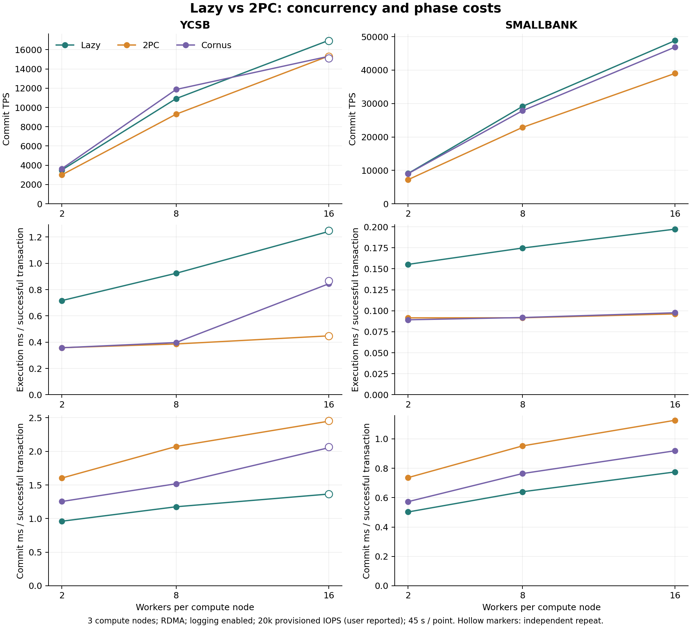
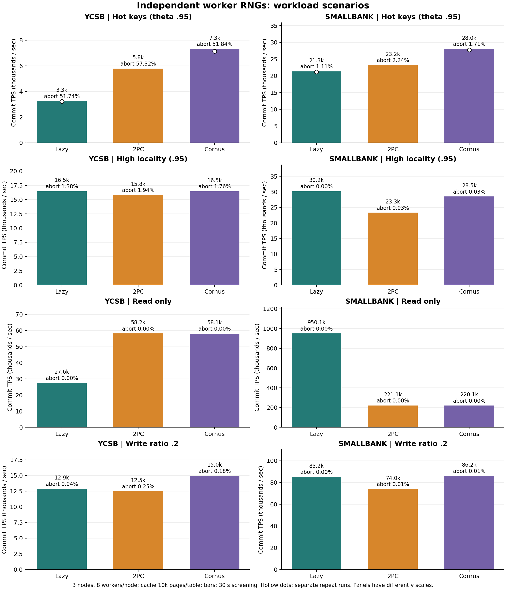

# YCSB / SmallBank 随机状态统一与重测（2026-11-05）

本轮统一 YCSB / SmallBank 的 worker 随机状态，完成 **51 次真实集群运行、153 份节点结果**。新增的关键发现是：YCSB 只读时，缓存从 10000 页增至 40000 页，Lazy 从约 2.76 万升到 22.8 万 TPS，和 Cornus 的胜负直接反转。热点下 Cornus 的优势则在两类负载的反向顺序复验中保留。

## 改动范围

两类负载统一为每个 worker 持有自己的 Zipf 生成器，固定 seed 由基础值 `0x48434d50`、计算节点编号、本地 worker 编号、随机流编号、目标分区编号、表编号经 `std::seed_seq` 派生，并截取为生成器支持的 48 位。事务类型/分区选择使用流 0，Zipf key 抽样使用流 1。协议模式与总 worker 数不参与 seed 派生。

- YCSB 原来把可变 Zipf 生成器放在共享的 YCSB 对象里。thread_local 指针不代表所指对象独立；多个 worker 会同时修改同一 RNG 状态。本次将其移到 worker 的 thread_local 容器。
- SmallBank 原来每个 worker 已有独立生成器，但 seed 取自 CPU 时钟，并在同一 worker 的不同分区、表之间复用。本次去掉时钟 seed，与 YCSB 使用同一初始化函数；容器直接持有生成器值，替换原来的多层裸指针分配。
- 两类负载的普通事务抽样也采用固定 worker seed，避免节点的全局线程号随线程数变化而改变已有 worker 的 seed。
- θ、各分区真实 key 数量、排名到 key 的映射保持不变；未改变协议、日志策略、RDMA、事务读写集规则或数据布局。各 worker 仍访问共同热点，只是抽样序列不同。

同样配置、数据映射和二进制下，每个 worker 的访问 key、事务类型和分区选择抽样序列可复现。YCSB 的随机字段内容仍由原有 thread_local 字符串生成器产生，不影响 key 选择，本轮未修改它。这不意味着时间模式的事务数量、跨 worker 调度、回滚数和 TPS 完全相同。θ 是分布参数，不是 seed；有限样本的热点比例也不会逐项完全相同。

## 验证与实验方法

在真实阿里云开发/存储节点编译 compute_server、storage_pool、remote_node，并同步至三个计算节点；未增加仓库内模拟测试脚本。四台运行副本源码指纹均为 `a6439e2d6f17b7ddd0fd58e97fff47d53075b172265dbd1e81c8d64352f9c7a1`，逐文件源码与二进制 SHA256 保存在结果目录的 deployment_audit.json。

构建沿用当前 CMake 的 `-O0 -DDEBUG`，所有模式一致；本轮结果用于当前实现的机制定位，不代表优化构建的峰值性能。正式 CPU 瓶颈、只读吞吐结论应在统一优化构建下复验。

运行配置：三个计算节点，每节点 8 vCPU；RDMA 开启、NO_WAIT、generate_log=1；日志后台周期 3 ms、记录触发阈值 16。云盘 20000 预配置 IOPS 来自用户说明，本轮未通过云 API 再次读取。存储节点同时运行 remote_node。

- 并发扫描：YCSB / SmallBank × 每节点 2、8、16 worker × Lazy、2PC、Cornus，每点 45 秒；θ=0.6、local_ratio=0.5、write_ratio=0.8。
- 场景扫描：每节点 8 worker，每点 30 秒；分别将 θ 改为 0.95、local_ratio 改为 0.95、write_ratio 改为 0、0.2。每个场景其余参数保持基线，三个模式的顺序预先打乱。
- 追加验证：YCSB 16 worker 的三个模式反向顺序各跑 45 秒；两类热点负载的 Lazy/Cornus 反向顺序各跑 30 秒；YCSB 只读将每表缓存从 10000 页增至 40000 页，Lazy/Cornus 各跑 30 秒，验证缓存容量的影响。仅这两个容量实验修改缓存，其余都为 10000 页。
- Cornus 为 `2pc-cornus`；这轮不引入 mix 或 Cornus 存储通知优化版。
- 结果目录：服务器 `/data/workspace/Hybrid_Cloud_MP/result/worker_rng_study_20261105`，本地保存同名 result 副本。计划、有效配置、节点结果、TPS 时序、存储统计、四机系统采样与分析脚本随结果保存。

最终校验：计划内 51 个点全部完成，合计 90,156,107 次尝试、88,741,202 次成功提交；153 份节点结果的事务计数、四类提交路径与日志等待分类累计值均对齐。有效配置中的 RDMA、运行时间、日志开关和每表缓存页数符合各 case 计划。四机源码指纹一致，RDMA 限速丢包计数为零，结束后未遗留三个数据库服务进程。详见结果目录 final_validation.json 和 post_run_deployment_audit.json。

另外在服务器直接使用项目的 ZipFanGen、thread_params 和当前 WorkerRandomSeed 函数进行临时采样检查：3 节点 × 16 worker 的事务选择/分区/表随机流合计 336 个 seed 无重复；每个 θ 下 8 个 worker 各抽样 50 万次，相同 seed 的重放逐项相同，不同 worker 的序列摘要均不同。n=30000 时，θ=0.6 的前 100 名命中比例为 9.123%–9.181%，θ=0.95 为 40.913%–41.046%。该检查只验证生成器序列，数据库的并发调度仍不要求确定性。临时工具和输出随结果保存，未加入仓库的测试目录。

原始结果压缩包 SHA256：`5c8a5f06565cb62cee1f6f99563f424f625c0043b8b656617ed9592d4144e67b`。本地与服务器副本一致。

## 指标口径

本文执行和提交均值按成功事务计算，避免高回滚率把每次尝试的均值摊低；原始每次尝试均值、回滚率及只读/单本地写/单远程写/多写路径也保存在 metrics.json。Commit TPS 是三个节点各自计时窗口的成功提交速率之和，另外保留剔除启动区间的 steady_tps。

所有权获取和 remote fetch 的单次时间分别包含各自处理路径，不能当作相同工作量的纯网络 RTT。提交阶段重新取页时间包含在 commit 内。日志等待含参与者工作，可与协调者阶段重叠；不能把细项相加为事务关键路径。设备写 IOPS、fdatasync 次数和 WAL 字节分别测量，不能相互替代。

YCSB 的 write_ratio=0.8 是每个事务 10 个 key 中 8 写 2 读；SmallBank 的同名参数是写事务类型比例。local_ratio 也不是实际本地记录比例；SmallBank 两表分别洗牌，同一账户的两表记录可能分属不同节点。

修复前的 YCSB 存在共享随机状态；SmallBank 旧版又用了时钟 seed。因此新旧吞吐的差值不能直接解释成“消除数据竞争带来的加速”。本轮应主要比较统一版本内部的各协议，旧实验仅提供历史参考。

当前 2PC 的 GetDataItem 按记录发请求，但成功响应返回 PAGE_SIZE（当前 4096 字节）的整页，调用端再拷贝目标记录。只读对照因此包含当前远程取数接口与 Lazy 页面缓存复用的差别，不能推广为所有远程执行实现的上限。本轮也不构成 Cornus 故障恢复正确性验证。

## 核心结论

### 1. 缓存容量可以直接改变两种执行方式的胜负

只读 SmallBank 中，Lazy 约 95 万 TPS，Cornus 约 22 万；但默认缓存下的只读 YCSB 恰好相反。追加容量对照确认，不能仅按“只读/写入”给执行方式贴标签。

YCSB 有 100000 条记录、约 3.3 万个数据页；每节点每表默认缓存 10000 页（约 39 MiB），增至 40000 页（约 156 MiB）后可容纳整个表。保持访问 seed、θ、线程、协议、数据规模和测量时长不变：

| 每表缓存页数 | 模式 | Commit TPS | 稳态 TPS | 成功执行 ms | 淘汰页数（约） | 取页/权限获取次数每 attempt |
|---:|---|---:|---:|---:|---:|---:|
| 10000 | Lazy | 27555 | 27561 | 0.854 | 3979310 | 4.8499 |
| 10000 | Cornus | 58129 | 58614 | 0.399 | 794349 | 0.0000 |
| 40000 | Lazy | 228047 | 233350 | 0.091 | 0 | 0.0144 |
| 40000 | Cornus | 64621 | 65145 | 0.357 | 0 | 0.0000 |

表中取页/权限获取次数使用现有 ownership_transfer_count：它也统计只读共享权限/页面获取，不等于发生了相同次数的排他所有权转移。Cornus 为 0 表示它走 remote fetch，不表示没有网络请求。两档缓存的只读运行均无 fdatasync。

Lazy 在跨节点读时会缓存不同分区的页面，因此单节点工作集可能大于固定 owner 执行。默认缓存下，YCSB Lazy 的淘汰与重新取页持续发生；扩大缓存后淘汰归零，TPS 大幅提升，反而明显快于 Cornus。SmallBank 每张表更紧凑，默认缓存下未观察到淘汰。

后续应分别测量“本地工作集能放下”和“跨节点副本放不下”的情况。当前 YCSB 含写场景也沿用 10000 页；尚未单独隔离其中容量失效与写入一致性引发的页面往返。

#### 对混合执行选择的启示

这个现象可由缓存容量与副本复用解释，同时提供了一个值得纳入混合设计的因素：**把页面取到本节点后的复用收益，以及该副本占用缓存、挤出其他页面的代价。** 它不只是一个实验配置问题，也不应仅用热点偏斜 θ 或读写比例替代。

- 请求节点能保留副本、后续重复访问多时，Lazy 可以把多次远程请求摊销为一次取页，之后直接访问本地内存。
- 请求节点缓存紧张或副本复用少，而固定 owner 能保留所需数据时，代执行可以避免扩大请求节点工作集以及随之发生的淘汰、重新取页。
- 需要区分“请求节点没有页面”“owner 没有页面”“存储端 OS 缓存也没有页面”。这些状态对应的代价不同；集群某处有缓存，不等于当前执行方式能免费复用它。
- 对写事务，还必须结合页面失效/转移、行冲突、实际写参与者数及提交代价，不能只根据缓存命中选择路径。

候选观测量包括：本地驻留/可用权限、缓存占用与淘汰速率、预期副本复用、owner 侧取数代价，以及提交路径成本。这是本轮结果支持的设计方向，尚未实现或验证相应的混合决策策略。缓存充足与缓存受限两类实验都应保留，分别观察其优势边界。

#### 为什么小缓存实验有存储取页，但设备读 IOPS 为 0

这里的小缓存是**计算节点的数据库 BufferPool**；并未限制存储节点的 Linux page cache。正常数据取页调用链为：

```text
计算节点缓存未命中
  → GetPage / GetPageWithLsn RPC
  → DiskManager::read_page / read_page_with_lsn
  → pread()
  → Linux page cache 命中：从存储节点内存返回
    Linux page cache 未命中：才需要向块设备发起读取
```

代码依据：`core/storage/storage_rpc.cc` 的这两条 RPC 直接调用 DiskManager，没有经过 StorageBufferPoolManager；`core/storage/disk_manager.cc` 用 `open(..., O_RDWR)` 打开数据文件，再通过 `pread()` 读取，未启用 `O_DIRECT`。因此调用 read_page 并不意味着产生一次设备读 I/O。此前“可能命中存储 BufferPool 或 OS 缓存”的解释，在这两条数据取页路径上应具体落实为 **OS page cache**。

复核原始证据：

- 默认 10000 页缓存的 YCSB 只读实验，Cornus 的 45 份、Lazy 的 46 份存储节点系统采样中，`/proc/diskstats` 的 `nvme0n1` 已完成读请求计数均始终为 **36341**；不是低 IOPS 被显示精度抹成 0。所用稳态子窗口也没有设备读计数增长。
- 复核服务器挂载，运行目录所在 ext4 文件系统位于 `/dev/nvme0n1p3`，采样的是其父设备 `nvme0n1`。
- 稳态存储节点 RDMA 发送流量：Lazy 约 **287.5 MB/s**，Cornus 约 **128.2 MB/s**。设备读 IOPS 为零并不表示没有取页服务或网络开销。
- 数据规模约 130 MiB，存储实例约 32 GiB 内存；运行前数据生成/预热及此前访问均可能让数据进入 page cache。没有逐次缓存命中追踪，但普通 buffered I/O 路径与设备计数不增长共同支持：这次采样期间的取页由内存缓存满足，而非持续从云盘读取。

因此本轮观测是“计算端小缓存引起大量远程取页，而存储端数据仍热在内存中”。即便没有实际云盘读取，RPC、网络传输、内存拷贝、页权限和淘汰管理也足以产生显著成本。它还不能量化存储端缓存也放不下时的物理读盘代价。

后续如果研究真实读盘场景，应单独控制数据集与存储侧可用缓存的关系，记录预热方式，并同时观察存储取页、OS 缓存与块设备读计数；作为新的实验条件处理，不与本轮结果混用。本次仅补充解释及混合设计假设，没有清理服务器 page cache，也没有改变 I/O 或缓存配置。

### 2. 热点下，执行和回滚成本足以盖过提交轮数

- ycsb：首轮 Lazy/Cornus 为 3262/7320 TPS，Cornus 高 124.4%；反向顺序复验为 3226/7136，高 121.2%。
- smallbank：首轮 Lazy/Cornus 为 21305/28030 TPS，Cornus 高 31.6%；反向顺序复验为 21131/27752，高 31.3%。

热点 YCSB 首轮回滚率 Lazy/Cornus 为 51.74%/51.84%，并非单纯靠更高的回滚率缩短事务。成功执行为 1.913/0.353 ms，失败事务总耗时为 3.488/1.397 ms。Lazy 提交重新取页为 327.4 μs/attempt；它的 fdatasync 均值 0.429 ms 还低于 Cornus 的 0.488 ms，但提交并未因此更快。

### 3. 看实际参与者，而不是只看 local_ratio

local_ratio 从 0.5 提至 0.95：YCSB/Cornus 的多写成功事务比例从 48.98% 降到 3.98%，Lazy/Cornus 均约 1.65 万 TPS；SmallBank 的多写比例仍约 25%，原因是两表账户布局独立。高本地性使 YCSB 的分布式提交额外代价明显减小，SmallBank 则没有消除跨表多写。

### 4. 多个持久投票不等于固定倍数的物理 IOPS

8 worker YCSB 基线中，Lazy/Cornus 每成功事务的 WAL 约 10.55/14.98 KB，但 fdatasync 次数约 0.399/0.325；每批日志记录约 43.1/60.6。Cornus 有更多 WAL 字节，却因实际合批方式产生更少的物理同步次数。设备 IOPS、WAL 字节、同步次数与事务关键路径必须分别测量。

普通 2PC 的多写路径额外决议日志仍有明显代价：8 worker YCSB 的多写提交约 2.899 ms，其中决议日志约 1.218 ms；Cornus 多写提交约 1.728 ms。SmallBank 相应为 1.924 ms（决议日志 0.823 ms）和 1.133 ms。

### 5. 16 worker 的 Cornus 执行侧退化可以复现，但原因尚未定位

- lazy：首轮/复验 TPS 16965/16905；成功执行 1.243/1.250 ms；成功提交 1.365/1.367 ms。
- 2pc：首轮/复验 TPS 15340/15303；成功执行 0.448/0.448 ms；成功提交 2.449/2.456 ms。
- 2pc-cornus：首轮/复验 TPS 15312/15125；成功执行 0.844/0.867 ms；成功提交 2.054/2.067 ms。

Cornus 单次 remote fetch 约 138–141 μs，普通 2PC 约 97 μs；四机未记录 RDMA 限速丢包。此处不能仅按提交协议轮数判断性能，也不能从整机 CPU 未满推出没有局部串行瓶颈。下一步需定位取页、缓存淘汰、线程调度与服务队列的等待，本轮不凭猜测修改这些路径。

## 下一步建议

1. 先让 CMake 支持显式选择优化构建；当前脚本强制 Debug/-O0，仅传 Release 参数未必生效。用统一优化构建复验关键点。
2. 固定两档缓存容量，重跑普通写入与热点写入，拆开容量不足和页面一致性成本。
3. 对 16 worker 的 Cornus 远程取数退化做局部等待定位，再决定是否需要调整 RPC/缓存实现。混合策略应建立在这些成本边界明确之后。


## 完整实验表

### 并发扫描

下列阶段均值为 ms/成功事务；TPS 为集群成功提交速率。

| 负载 | worker/节点 | 模式 | Commit TPS | 执行 ms | 提交 ms | 回滚率 | fdatasync ms | 设备写 IOPS |
|---|---|---|---|---|---|---|---|---|
| ycsb | 2 | Lazy | 3497 | 0.716 | 0.960 | 0.46% | 0.404 | 11199 |
| ycsb | 2 | 2PC | 2996 | 0.358 | 1.602 | 1.14% | 0.447 | 14040 |
| ycsb | 2 | Cornus | 3630 | 0.357 | 1.254 | 1.00% | 0.482 | 13568 |
| ycsb | 8 | Lazy | 10920 | 0.924 | 1.176 | 2.32% | 0.527 | 13208 |
| ycsb | 8 | 2PC | 9303 | 0.386 | 2.072 | 5.31% | 0.499 | 11988 |
| ycsb | 8 | Cornus | 11870 | 0.397 | 1.518 | 4.33% | 0.490 | 11844 |
| ycsb | 16 | Lazy | 16965 | 1.243 | 1.365 | 5.45% | 0.521 | 12266 |
| ycsb | 16 | 2PC | 15340 | 0.448 | 2.449 | 9.72% | 0.495 | 10178 |
| ycsb | 16 | Cornus | 15312 | 0.844 | 2.054 | 7.80% | 0.488 | 8689 |
| smallbank | 2 | Lazy | 9050 | 0.155 | 0.502 | 0.00% | 0.297 | 17047 |
| smallbank | 2 | 2PC | 7204 | 0.092 | 0.736 | 0.01% | 0.297 | 15847 |
| smallbank | 2 | Cornus | 9003 | 0.089 | 0.572 | 0.00% | 0.295 | 15800 |
| smallbank | 8 | Lazy | 29137 | 0.175 | 0.640 | 0.00% | 0.353 | 15381 |
| smallbank | 8 | 2PC | 22855 | 0.092 | 0.952 | 0.03% | 0.355 | 15093 |
| smallbank | 8 | Cornus | 27840 | 0.092 | 0.764 | 0.02% | 0.371 | 14702 |
| smallbank | 16 | Lazy | 48830 | 0.197 | 0.775 | 0.01% | 0.429 | 13828 |
| smallbank | 16 | 2PC | 39022 | 0.096 | 1.126 | 0.07% | 0.435 | 13747 |
| smallbank | 16 | Cornus | 46887 | 0.098 | 0.919 | 0.05% | 0.474 | 13404 |



### 场景扫描

| 负载 | 场景 | Lazy TPS | 2PC TPS | Cornus TPS | Cornus 相对 Lazy |
|---|---|---|---|---|---|
| ycsb | θ=0.95 | 3262 | 5791 | 7320 | +124.4% |
| ycsb | local_ratio=0.95 | 16474 | 15810 | 16467 | -0.0% |
| ycsb | 只读 | 27555 | 58167 | 58129 | +111.0% |
| ycsb | write_ratio=0.2 | 12904 | 12482 | 14954 | +15.9% |
| smallbank | θ=0.95 | 21305 | 23198 | 28030 | +31.6% |
| smallbank | local_ratio=0.95 | 30231 | 23334 | 28531 | -5.6% |
| smallbank | 只读 | 950130 | 221063 | 220081 | -76.8% |
| smallbank | write_ratio=0.2 | 85200 | 73962 | 86210 | +1.2% |



| 负载 | 场景 | 模式 | 执行 ms/成功事务 | 提交 ms/成功事务 | 回滚率 | 提交取页 μs/attempt | 计算 CPU busy |
|---|---|---|---|---|---|---|---|
| ycsb | θ=0.95 | Lazy | 1.913 | 1.660 | 51.74% | 327.4 | 24.1% |
| ycsb | θ=0.95 | 2PC | 0.349 | 1.922 | 57.32% | 1.4 | 20.0% |
| ycsb | θ=0.95 | Cornus | 0.353 | 1.388 | 51.84% | 1.7 | 23.5% |
| ycsb | local_ratio=0.95 | Lazy | 0.224 | 1.176 | 1.38% | 16.9 | 19.9% |
| ycsb | local_ratio=0.95 | 2PC | 0.165 | 1.292 | 1.94% | 7.6 | 15.0% |
| ycsb | local_ratio=0.95 | Cornus | 0.164 | 1.234 | 1.76% | 7.8 | 16.0% |
| ycsb | 只读 | Lazy | 0.854 | 0.002 | 0.00% | 0.0 | 59.5% |
| ycsb | 只读 | 2PC | 0.398 | 0.002 | 0.00% | 0.0 | 53.7% |
| ycsb | 只读 | Cornus | 0.399 | 0.001 | 0.00% | 0.0 | 53.6% |
| ycsb | write_ratio=0.2 | Lazy | 0.854 | 0.979 | 0.04% | 6.9 | 37.6% |
| ycsb | write_ratio=0.2 | 2PC | 0.362 | 1.537 | 0.25% | 0.8 | 18.0% |
| ycsb | write_ratio=0.2 | Cornus | 0.365 | 1.217 | 0.18% | 0.9 | 21.4% |
| smallbank | θ=0.95 | Lazy | 0.347 | 0.736 | 1.11% | 142.2 | 19.9% |
| smallbank | θ=0.95 | 2PC | 0.091 | 0.923 | 2.24% | 0.2 | 15.6% |
| smallbank | θ=0.95 | Cornus | 0.092 | 0.747 | 1.71% | 0.2 | 18.5% |
| smallbank | local_ratio=0.95 | Lazy | 0.130 | 0.655 | 0.00% | 1.8 | 20.5% |
| smallbank | local_ratio=0.95 | 2PC | 0.070 | 0.951 | 0.03% | 0.3 | 13.8% |
| smallbank | local_ratio=0.95 | Cornus | 0.071 | 0.764 | 0.03% | 0.3 | 16.0% |
| smallbank | 只读 | Lazy | 0.016 | 0.003 | 0.00% | 0.0 | 90.2% |
| smallbank | 只读 | 2PC | 0.102 | 0.002 | 0.00% | 0.0 | 54.5% |
| smallbank | 只读 | Cornus | 0.102 | 0.002 | 0.00% | 0.0 | 54.9% |
| smallbank | write_ratio=0.2 | Lazy | 0.125 | 0.150 | 0.00% | 1.0 | 46.5% |
| smallbank | write_ratio=0.2 | 2PC | 0.090 | 0.229 | 0.01% | 0.1 | 25.5% |
| smallbank | write_ratio=0.2 | Cornus | 0.092 | 0.181 | 0.01% | 0.1 | 29.9% |

### 多写提交路径：8 worker 基线

| 负载 | 模式 | 多写占成功事务 | 多写提交 ms | prepare ms | 决议日志 ms | final commit ms |
|---|---|---|---|---|---|---|
| ycsb | 2PC | 49.0% | 2.899 | 1.547 | 1.218 | 0.127 |
| ycsb | Cornus | 49.0% | 1.728 | 1.589 | 0.000 | 0.133 |
| smallbank | 2PC | 25.0% | 1.924 | 0.997 | 0.823 | 0.100 |
| smallbank | Cornus | 24.9% | 1.133 | 1.032 | 0.000 | 0.097 |

### 复验

独立启动服务，复用固定 worker seed；不保证跨 worker 调度、完成事务数和回滚数相同。

| 负载 | 场景 | 模式 | 秒 | Commit TPS | 执行 ms | 提交 ms | 回滚率 |
|---|---|---|---|---|---|---|---|
| ycsb | 只读，40000 页缓存 | Cornus | 30 | 64621 | 0.357 | 0.001 | 0.00% |
| ycsb | 只读，40000 页缓存 | Lazy | 30 | 228047 | 0.091 | 0.002 | 0.00% |
| ycsb | 16 worker 基线 | Lazy | 45 | 16905 | 1.250 | 1.367 | 5.48% |
| ycsb | 16 worker 基线 | Cornus | 45 | 15125 | 0.867 | 2.067 | 7.82% |
| ycsb | 16 worker 基线 | 2PC | 45 | 15303 | 0.448 | 2.456 | 9.68% |
| ycsb | θ=0.95 | Lazy | 30 | 3226 | 1.926 | 1.676 | 51.82% |
| ycsb | θ=0.95 | Cornus | 30 | 7136 | 0.356 | 1.431 | 51.83% |
| smallbank | θ=0.95 | Cornus | 30 | 27752 | 0.092 | 0.755 | 1.69% |
| smallbank | θ=0.95 | Lazy | 30 | 21131 | 0.350 | 0.741 | 1.11% |
